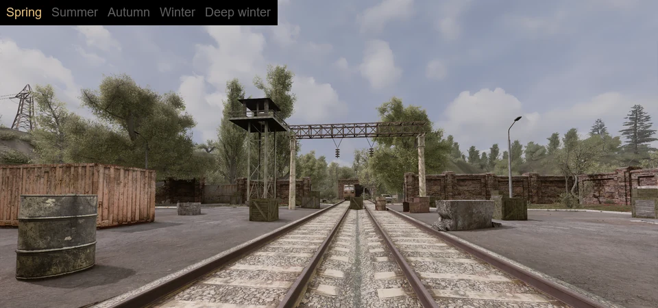
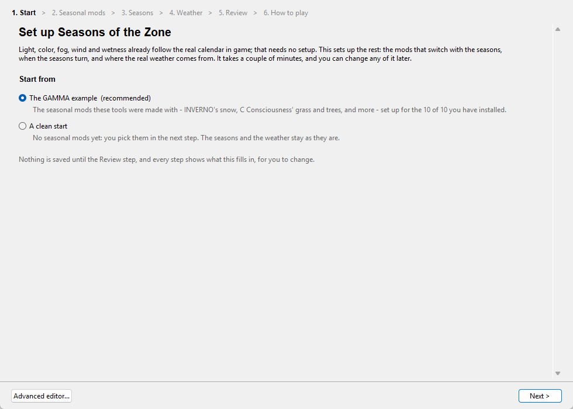
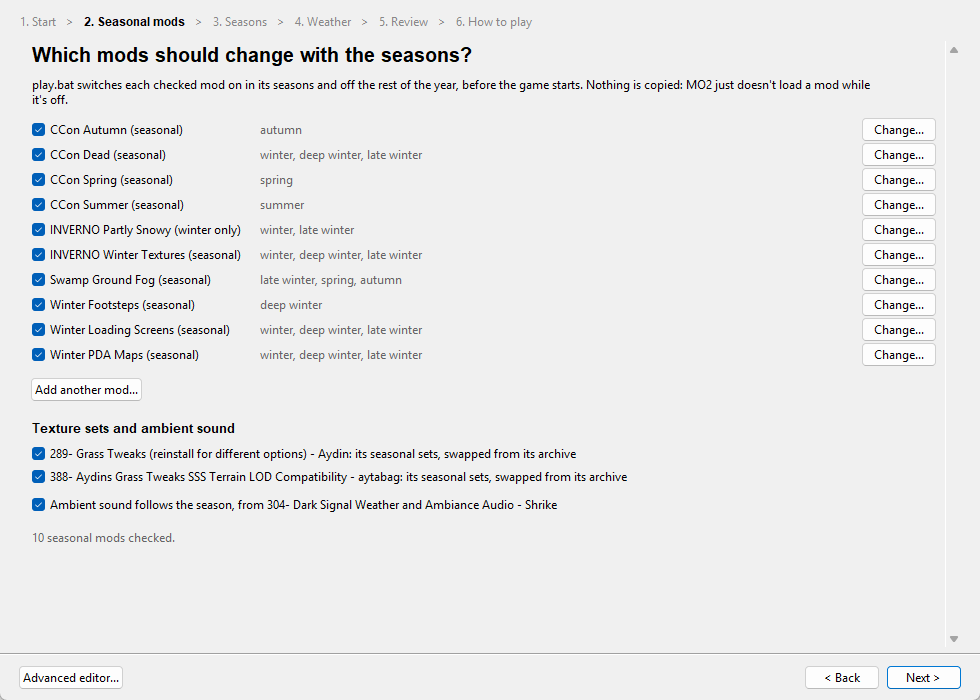
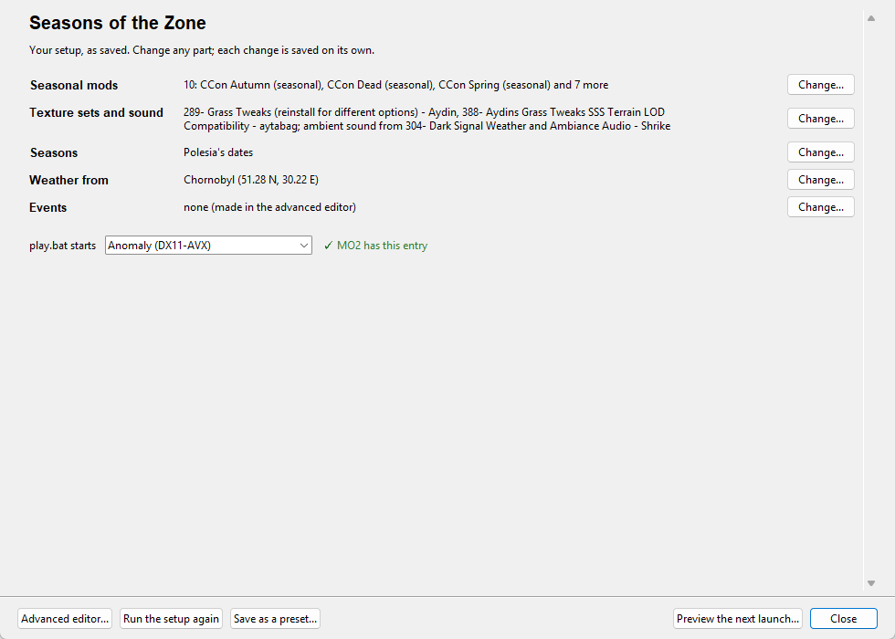
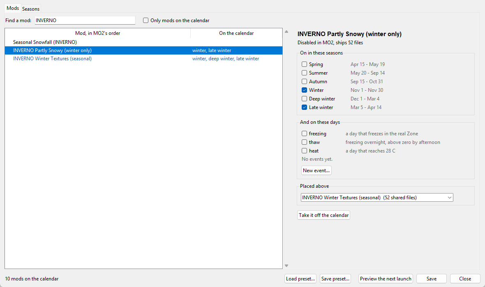
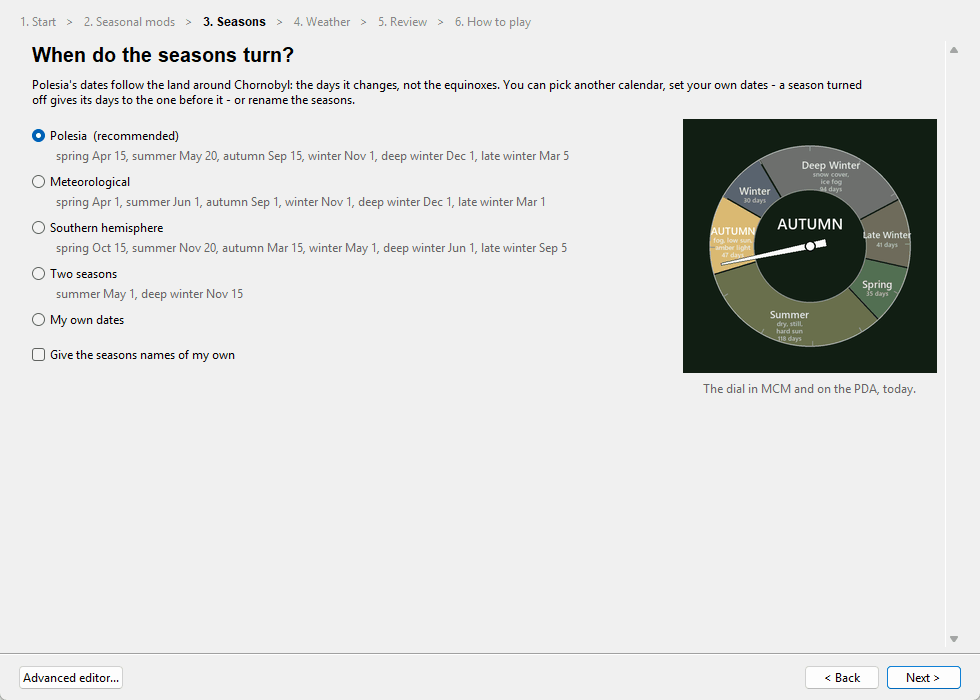
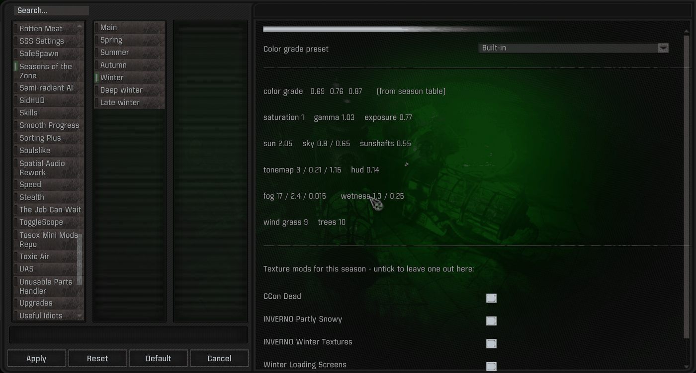

# Seasons of the Zone

**Point a mod at a stretch of the real calendar. It loads itself when that time of year
comes around, and unloads when it passes.**

The Zone follows the real-world calendar. Boot the game in late October, and it is autumn,
because Chornobyl is in autumn.



Light, color, fog, wind, wetness, snowfall, and ambient sound change with the date and
blend across each season boundary. Nothing to download beyond this mod, nothing to
configure.

That is the part that works out of the box. Underneath it is a scheduler, and the six
seasons are the calendar it ships with — see
**[the calendar underneath](#the-calendar-underneath)**.

It ships no textures. The snow, the leaves and the grass in the pictures are other mods,
INVERNO and C-Consciousness among them, which you install and pick in the setup; Seasons
of the Zone switches them on in their seasons and off the rest of the year. The Zone can
also keep [its own date by the game's clock](#the-games-own-clock) instead of the real one.

The setup, the PDA, MCM and the messages in game are in English and Russian.
[docs/TRANSLATING.md](docs/TRANSLATING.md) says how to add another language.

*More of the interface: [docs/INTERFACE.md](docs/INTERFACE.md)*

---

## What it does

Twenty console values are set per season and blended across a 14-day window centered on
each boundary:

| Layer | What changes |
|---|---|
| Color and light | grade, saturation, gamma, exposure, sun lumscale, tonemap, sunshafts |
| Foliage | specular and sun-through-leaf (`ssfx_florafixes_1/2`) |
| Fog | `ssfx_fog`, `ssfx_fog_scattering` |
| Wind | `ssfx_wind_grass`, `ssfx_wind_trees` |
| Wetness | `ssfx_wetness_multiplier` — the thaw is the wettest, summer dries fast |

There is a year dial on the Main page, a PDA message when you load in, and a Seasons app
in the PDA that shows what the Zone runs and why, and what is on and coming.

**Six seasons.** Winter comes in three parts: in Polesia snow starts falling in November,
settles from December, and thaws through March into mud before anything turns green.

```
spring       Apr 15 - May 19    35 d   green-up
summer       May 20 - Sep 14   118 d   full foliage
autumn       Sep 15 - Oct 31    47 d   leaves turn; October is the peak
winter       Nov 01 - Nov 30    30 d   first snowfall, bare ground
winter_snow  Dec 01 - Mar 04    94 d   snow on the ground
late_winter  Mar 05 - Apr 14    41 d   the thaw: patchy snow, mud, bare trees
```

These are the dates the landscape changes, not the equinoxes, and they are only the
default. `configure.bat` moves the day any season starts, turns seasons off
and renames them, for a year of only summer and deep winter, say, or one on Ukraine's
meteorological dates. A season turned off gives its days to the one before it, and the
game, MCM and the dial all follow.

---

## The calendar underneath

Seasons of the Zone is two independent halves, and you can use either on its own.

| | What it is | Configurable? |
|---|---|---|
| **Seasonal atmosphere**, in game | Twenty console values blended across the date. Color, fog, wind, wetness. | Its strength, per layer, in MCM |
| **Seasonal mods**, at launch | A scheduler that decides which mods MO2 mounts today | Yes — this is the open half |

The seasonal-mods half has nothing seasonal about it. It maps a date to a set of names,
and mods declare which names they belong to. The six seasons are the default set. You can
add your own.

**Base periods** partition the year — exactly one is active on any date. **Events** overlay
whatever period they land in, so they add without displacing:

```python
# _tools/seasons_config.py
EVENTS = {
    "christmas": ((12, 24), (12, 26)),    # start, end - inclusive
    "halloween": ((10, 31), (10, 31)),    # a single day is fine
    "twelvetide": ((12, 26), (1, 6)),     # a window may wrap the year end
    "weekend": {"weekdays": ("sat", "sun")},   # or a rule: weekdays, days of the month...
}

TOGGLE_MODS = {
    "Christmas Lights": {"when": ("christmas",), "above": "..."},
}
```

On December 25th the game stages deep winter **and** Christmas. The snow does not go
anywhere — that is what "overlay" means, and it is the difference between a mod that
does seasons and one that can do occasions.

Nothing about a period has to be a texture. If MO2 can mount it as a folder, it can be
made seasonal: a gameplay patch, an audio set, a spawn table, a loading screen. The
texture packs are the obvious first use.

```python
PERIODS = {                    # extra base periods, alongside the seasons
    "high_summer": (7, 1),     # runs until the next period starts
}
```

**Seasons of your own** are named stretches of the year, a week or longer - up to 52 of
them - that run on top of the season they fall in, as events do. A wormhole anomaly mod
made the usual way can come on for "Wormhole season" in August and leave summer's mods
where they are.

**Spells** come by chance. On each day of the seasons a spell names there is a chance it
starts, and then it runs 1 to 6 days. A spell can bring another season with it: a spell
of winter in summer switches the winter mods on and summer's off, and the game's light and
weather follow it until it ends. The date decides, so every launch that day agrees.

```python
OWN_SEASONS = {
    "Wormhole season": ((8, 1), (8, 31)),        # first and last day, a week or longer
}
SPELLS = {
    # in summer, a 3% chance each day of a day or two of winter
    "Summer frost": {"in": ("summer",), "chance": 3, "days": (1, 2), "as": "winter"},
}
```

Full reference: **[docs/SCHEDULING.md](docs/SCHEDULING.md)**.

---

## Six days the Zone marks

Six fixed dates ship with the mod, each laid over whatever season is running rather than
replacing it. April 26 is still spring underneath; December 14 is still deep winter.

Two are **remembrance days** and the Zone goes quiet:

| | |
|---|---|
| **April 26** | International Chernobyl Disaster Remembrance Day |
| **December 14** | Liquidators' Day |

The weather is held clear and the PDA carries the day. No reward, no drop, no map marker.

Four are **anniversaries** — the release dates of the mainline games — and they pull the
other way. The weather is pushed to storm and a few extra artifacts are seeded on each
level you visit, roughly zero to five, once per level per day.

| | |
|---|---|
| **March 20** | Shadow of Chernobyl |
| **August 22** | Clear Sky |
| **October 2** | Call of Pripyat |
| **November 20** | Heart of Chornobyl |

Each day carries its own PDA traffic — an opening transmission shortly after you load in,
then more at intervals of eight to twenty minutes, drawn from that day's pool. 108 lines
in all, across eight voices, each signed and carrying that speaker's portrait: Barman,
Sidorovich, Owl, Beard, Sakharov, Forester, Nimble, and an unnamed guide.

The anniversary lines count the years **in-world**, from the in-game clock against the
year each game is set in — Shadow of Chernobyl in May 2012, Clear Sky in 2011, Call of
Pripyat in August 2012. A fresh save hears *"6 years since Operation Fairway"*, and the
count advances as the save ages. Heart of Chornobyl is set in 2021-22, still ahead of
Anomaly's own calendar, so it carries no count at all.

Five switches on the MCM Main page turn any of it off. The artifact seed is the only part
of the mod that writes to your save.

---

## Requirements

- S.T.A.L.K.E.R. Anomaly with **G.A.M.M.A.**, through **Mod Organizer 2** (portable)
- **Screen Space Shaders** and the **Modded Exes** DX11 build GAMMA ships with it. Nine of
  the twenty values are SSS's own; an older exe does not have them, and the mod says so in
  the log.
- **MCM**
- **Mod App Creator**, for the PDA app's tile in its launcher. Without it, the app opens on a
  key you set on MCM's Main page, which shows in red while the app has no way in.
- **Python 3**, for `play.bat` and `configure.bat` only. The python.org installer is
  enough.
- For some things only: the py7zr package to open a `.7z` - an optional `LAYOUT` texture
  set's, a LUT pack's, or a mod's installed from the setup - and rarfile plus WinRAR or
  7-Zip for a `.rar`. The setup offers to install either package when it is needed. By
  hand, type `py -m pip install py7zr` (or `rarfile`) in Command Prompt, not in Python.
  `py -m pip install pillow` draws the year dial for a calendar of your own.

### Outside GAMMA

| | Plain Anomaly | Anomaly + Modded Exes |
|---|---|---|
| Color and light | yes | yes |
| Foliage, fog, wind, wetness | no | with Screen Space Shaders |
| The six marked days | yes | yes |
| The read API for other mods | yes | yes |
| The Seasons PDA app | on a key | on a key, and from Mod App Creator |
| Texture and sound staging | with MO2 portable and Python | same |

- Foliage, fog, wind, and wetness use Screen Space Shaders' engine commands, which only exist
  in Modded Exes. Without them the mod logs it once and skips those layers.
- The PDA app opens on a key you set in MCM, in a window of its own. Mod App Creator, which
  requires Modded Exes, adds a tile in its launcher.
- Staging works with any MO2 portable install. It reads the game path and profile from
  `ModOrganizer.ini`.
- The anniversary artifacts need Dynamic Anomalies Overhaul.

Tested on Anomaly 1.5.3 with Modded Exes, MCM and Mod App Creator, and nothing else from
GAMMA: the seasonal atmosphere, the marked days, the PDA app and MCM all work, and the forecast
reads the base game's weather. Plain Anomaly without Modded Exes hasn't been run; its column
follows from what its engine lacks.

### With ROMEO

ROMEO, CLIKRΔD GROUP's repack built on GAMMA, hasn't been run with this mod yet. Where they
meet:

- **Its soundscape**, Dark Signal Amplified, sits above GAMMA's Dark Signal. Make it the
  source in `configure.bat`: under **Texture sets and ambient sound**, pick it in the list
  beside **Ambient sound follows the season**. Or run
  `py _tools\configure.py sound "<its name in MO2>"`. `season.py status` says when that is
  needed.
- **Its color grade**, Kumo's LUT, is applied after this mod's grade, so the two stack. If
  the result is too strong, lower **Intensity** on MCM's Main page.
- **RE:Done A-Life Performance** moves the new-game date a day earlier; the mod reads the
  date from `alife.ltx`, so the game's own clock follows it.
- **The PDA app** opens from Mod App Creator's tile, or on a key from MCM's Main page.

---

## Install

1. In MO2, use **Install a new mod from archive** on the release zip, then enable the mod.
   That's everything in game: the light and weather, the marked days, the PDA app and MCM.
2. For real-world temperatures and seasonal mods: in MO2, right-click the mod, choose
   **Open in Explorer**, and double-click `configure.bat` there. It puts `play.bat`,
   `configure.bat` and the `_tools` folder in your GAMMA folder, next to
   `ModOrganizer.exe`, and then walks you through the setup, a step at a time
   ([below](#making-a-mod-seasonal)). Its last step checks which MO2 entry `play.bat`
   starts.
3. Close MO2, and start the game with `play.bat` in your GAMMA folder. It opens MO2
   itself; it can't switch mods while MO2 is already open. Starting from MO2 still works
   ([below](#why-a-launcher)): `play.bat` is what moves the seasonal mods along with the
   date.

[docs/INSTALL-GUIDE.md](docs/INSTALL-GUIDE.md) shows every window of a first install, with
a screenshot of each.

**With Claude Code:** open it in your GAMMA folder (where `ModOrganizer.exe` is) and paste
*"Install Seasons of the Zone by following
https://raw.githubusercontent.com/devinhorowitz/seasonsofthezone/main/docs/INSTALL-WITH-CLAUDE.md"*.
It downloads the latest release, checks it against GitHub's checksum, installs and enables it
with MO2 closed, puts the tools in place, and can do the setup with you: where the weather comes
from and which of your mods switch with the season. It asks before every change, moves rather
than deletes, and keeps your setup on an update.
[docs/INSTALL-WITH-CLAUDE.md](docs/INSTALL-WITH-CLAUDE.md) is the whole procedure.

`play.bat` fetches the day's real weather - Chornobyl's, or a place you pick in the
setup - checks the date, switches the seasonal mods, and starts the game. Most days it changes nothing. Paths come from `ModOrganizer.ini`, so the
drive, game folder and profile are read rather than assumed. To see what the next launch
will do without starting anything, use **Preview the next launch** in `configure.bat`, or
run `py _tools\season.py status` in the GAMMA folder.

**Running a command:** the commands here run in a Command Prompt opened in your GAMMA
folder, the one with `ModOrganizer.exe` and `play.bat`. In File Explorer, open that folder,
click the path at the top, type `cmd` over it and press Enter. A Command Prompt from the
Start menu opens in your user folder instead, where `_tools` isn't. If `py` isn't found, use
`python`. If a command says `invalid choice`, the tools in your GAMMA folder are older than
it: open `configure.bat` from the mod's folder to update them, as under **Updating**.

**Updating:** install the new zip over the old one and choose **Replace**, then open
`configure.bat` from the mod's folder again, as in step 2. It updates the tools in your
GAMMA folder and keeps your setup and the MO2 entry `play.bat` starts. Versions before
1.7.0 were installed by copying the `mods/Seasons of the Zone` folder: name the new install
`Seasons of the Zone` so it replaces that copy.

**Removing it:** switch it off in MCM first (this restores the color grade to neutral),
then disable the mod. Seasonal mods stay as `play.bat` last left them; enable or disable
them in MO2 as you like. If you applied the snowfall patch, `--revert` it too; without the
mod, the addon snows whenever the weather says so.

**While a layer is on**, SSS's own MCM sliders for that layer, and the vanilla sunshafts
and gamma sliders, are overridden within five seconds. Switch the layer off to tune them
yourself.

---

## Why a launcher

The seasonal atmosphere changes in game, immediately. Terrain and grass textures can't: X-Ray
loads them from MO2's virtual file system when a level loads and keeps them for the
session. So seasonal mods have to be switched before the game starts, and that is what
`play.bat` does, along with the texture sets, the ambient sound,
[how much grass grows](#grass-by-the-season), a spell's season, MCM
settings that follow the season, and [the dice](#rolling-the-season).

It isn't needed to play. Started from MO2, everything else goes on by the date: the light
and weather, the marked days, the PDA and MCM, and the API other mods read. What
`play.bat` switched stays as it last left it until it runs again. The weather stays real
for as long as the forecast it last fetched reaches, 16 days; after that, and with no
connection at all, the temperature comes from the place's climate, so nothing that reads
it goes without. If you have no seasonal mods, launch however you like.

### The game's own clock

By default the Zone follows the real date. Set **Calendar runs on** on MCM's Main page to
**The game's clock** and it keeps its own date instead: the in-game date, so a night's
sleep moves it on, sped up by **Zone days per game day** from the day the game starts. At 1
the Zone's date is the in-game date; at 7 a week passes with each in-game day.

The light, weather, marked days, spells, PDA and MCM follow that date at once. The mods
`play.bat` switches can't change mid-session, so the game writes its date to
`appdata\seasons_clock.txt` as it saves and loads, and `play.bat` switches by it at the
next launch: the season of the game you last saved or loaded. Nothing is written into your
saves. The real weather is set aside while the Zone keeps its own date, since it is of
another day: the temperature comes from the place's climate on the Zone's date.

### Rolling the season

For a Zone that doesn't keep to the calendar, turn on **Roll the season at launch** on
MCM's Main page, or under **The dice** on `configure.bat`'s Seasons step. Each launch
through `play.bat` then rolls, and **Chance per launch** sets how often it hits: at 25, the
default, about one launch in four; at 100, every launch. A hit runs another season your
calendar has on, picked at random, until the next launch: the light, the weather, the
seasonal mods, texture sets and sound alike. The PDA and MCM's Main page say what was
rolled and what the calendar reads. A miss leaves the calendar's season, or a spell's.

A pinned season is never rolled over. A hit sets a spell's season aside, as a pin does,
though the mods on during the spell still come on, and so do the marked days, events and
seasons of your own, by the date. Starting from MO2 rolls nothing: the season `play.bat`
last rolled stays until it runs again. From a command prompt:

```
py _tools\configure.py dice on --chance 40
py _tools\configure.py dice off
```

### Grass by the season

The grass thins out in the cold. Each season's MCM page has **Grass this season (%)**: how
much of your grass it keeps, against the **Grass Density** set in the game's video options.
By default spring keeps 80, summer and autumn all of it, winter and late winter 60, and deep
winter 40. A level reads the density as it loads, so `play.bat` sets it in
`appdata\user.ltx` before the game starts. The game lays grass out in steps, so `play.bat`
takes the nearest and its report names it: at GAMMA's 0.25, deep winter comes out at about
44%, `r__detail_density 0.4`. The grass is never made denser than yours, so it costs no
frames.

A density you set with the slider becomes yours from the next launch on. **Grass follows the
season** on the Main page turns this off, and the next launch through `play.bat` puts your
own value back. [CONFIGURING.md](docs/CONFIGURING.md#grass-by-the-season) has the details.

---

## The MCM pages

**Mod Configuration Menu → Seasons of the Zone** has a Main page, then one for each
season your calendar has on: seven pages with the default calendar.

- **Main** — the year dial and today's date; the master switch; season (automatic, or
  pin one — a pin also decides what is staged at the next launch);
  [the dice](#rolling-the-season), a chance at each launch of another season; what the
  calendar runs on, the real date or [the game's own clock](#the-games-own-clock), and how
  fast;
  transition length (0 for a hard switch on the boundary date, 14 by default);
  intensity (0 is GAMMA's stock look, 1 the full season); one switch per layer: color,
  foliage, fog, wind, wetness, and [the season's LUT](#optional-seasonal-luts); the three
  launch-time switches, for textures, ambient sound and grass; the PDA messages, on loading
  in, as the season turns while you play, and, if you turn it on, as the weather turns; and
  **PDA notifications**, which silences every one of them, as **Silence** at the foot of the
  app's pages does.
- **Spring, Summer, Autumn, Winter, Deep winter, Late winter** — that season's color
  grade preset, [how much of your grass it keeps](#grass-by-the-season), a read-out of the
  values it resolves to, and a checkbox for each seasonal mod on in it. The pages take your
  own season names.
- **Your calendar** — with seasons of your own, events, periods or spells, a switch for
  each one's PDA message: when it is on as the game starts, and when it begins while you
  play.

### Trying a season

To see a season now, pick it under **Season** on MCM's Main page. The color, foliage,
fog, wind and wetness change within seconds. Texture sets, grass and the other seasonal
mods follow the next time you start through `play.bat`, since they can only switch
before the game starts; with none set up, the atmosphere is all that changes. Set
**Season** back to automatic to return to the calendar.

---

## Making a mod seasonal

Any installed mod can follow the calendar. You do not modify it; you say when it belongs.
A seasonal mod is switched on by `play.bat` in the seasons, events and weather you pick,
and off the rest of the year.

**With `configure.bat`.** The first time, it walks you through the setup in six steps:

1. **Start** from the GAMMA example - the seasonal mods these tools were made with, for the
   ones you have installed - from a preset of your own, or from nothing.
2. **Seasonal mods**: a checklist. **Change...** sets when one is on; **Add another
   mod...** makes any other mod seasonal; **Install one from an archive...** installs a
   mod you've downloaded and makes it seasonal in one go, with its installer's options and
   any fix file from its author. Archives in your GAMMA and downloads folders whose names
   say a season are listed there, ready to install. When two seasonal mods on at the same
   time ship the same files, it asks whose the game should use.
3. **Seasons**: Polesia's dates, another calendar, or your own, with the year dial as the
   game will draw it, and names of your own if you like. Here too you add seasons of your
   own and spells.
4. **Weather**: Chornobyl, or a place you look up.
5. **Review**: what `play.bat` will switch today. Nothing is written until you save here.
6. **How to play**: which MO2 entry `play.bat` starts, and how to start the game.





After that, `configure.bat` opens to a summary of your setup, with a **Change** button for
each part, **Run the setup again**, and **Preview the next launch**, which shows what
`play.bat` would switch.



Everything the steps leave out - events, and which mod wins over which - is in the
**Advanced editor**, a button away on every page. It works out the mod each seasonal mod
has to win over - where two mods ship the same file, MO2 uses the one lower in its list -
and checks the file before it writes it.



The same from a command prompt in your GAMMA folder, which is handy when someone is
helping you (use `python` in place of `py` if that is how your Python starts):

```
py _tools\configure.py add "INVERNO Winter Textures" --when winter "deep winter"
py _tools\configure.py event christmas 12-24 12-26
py _tools\configure.py season "Wormhole season" 08-01 08-31
py _tools\configure.py spell "Summer frost" --in summer --chance 3 --days 1 2 --as winter
py _tools\configure.py list
```

`py _tools\configure.py --help` lists every command.

The **Seasons** step sets the calendar itself: the day each season starts, which seasons
are on, and what each is called, with the dial the game will draw for it.
`py _tools\configure.py calendar` shows it, and
`py _tools\configure.py calendar summer=5-1 "deep winter=11-15" --only` makes a two-season
year.



Further down the same step, **Add a season of your own...** and **Add a spell...**, with
how often each spell comes on average, and [the dice](#rolling-the-season), saved to MCM's
own settings so the game's page shows the same.


The **Weather** step picks where the real weather comes from: Chornobyl, or a town you look
up by name. The PDA's temperature, its Forecast page and the freezing, thaw and heat days
follow the weather there.


**Presets** keep a setup under a name - the calendar and season names, the events, the
seasonal mods, texture sets and sound - to load again, or to share. The setup's first
step offers yours to start from, and the Review step saves nothing until you say. Load
one made on another install and the mods you don't have are left out. Four calendars come with the
tool, and a **GAMMA example**: the seasonal mods these tools were made with, set up for the
GAMMA mods you have installed. Its texture sets need `py7zr` (see
[Requirements](#requirements)), and it names mods by their folder names in GAMMA, so a mod
you have renamed is left out.


**By hand.** Both write `_tools\seasons_config.py`, which you can also edit yourself:

```python
TOGGLE_MODS = {
    "INVERNO Winter Textures": {                  # folder name, exactly as MO2 shows it
        "when": ("winter", "winter_snow", "late_winter"),   # seasons, events or weather
        "above": "388- Aydins Grass Tweaks SSS Terrain LOD Compatibility - aytabag",
    },                                            # ^ the mod it wins over
}
```

`when` takes any mix of seasons, events and weather. In the file, deep winter is
`winter_snow` and late winter is `late_winter`. `seasons` is the original spelling of the
same key and still works, so nothing written for an earlier version needs editing.

Start the game with `play.bat`. The mod is enabled in November and disabled in mid-April,
and appears on the Winter, Deep winter and Late winter pages with its file count and size.
Nothing is copied — MO2 stops mounting the folder — so an 11 GB texture set costs nothing
to switch.

To stop switching a mod, uncheck it on the Seasonal mods step, or run
`py _tools\configure.py remove "<mod>"`. `play.bat` then leaves it as it is in MO2. Every
save keeps the previous file as `seasons_config.py.bak`, to go back to.



*The packs shown are third-party texture mods, not included here.*

### Which mod it wins over (`above`)

`above` is the mod yours wins over. MO2 gives a shared file to the enabled mod with the
highest priority - the one lowest in its left pane - and if another mod wins over yours on
a file, yours loses it and nothing tells you. `configure.bat` picks `above` from the files
the mods share. To check by hand, pick a file your mod ships and ask, naming your mod with
`--for`:

```
py _tools\season.py whowins textures/map/map_escape.dds --for "Winter PDA Maps (seasonal)"
```

```
    line   190  disabled  Winter PDA Maps (seasonal)             2097280 B   <-- yours
    line   539  enabled   358- Global Map Rework - DeadEnvoy     8388736 B   <-- yours has to win over this one
    line   862  enabled   26- High Res PDA Maps - Bazingarrey    8388736 B

  Make Winter PDA Maps (seasonal) win over:  358- Global Map Rework - DeadEnvoy
```

Use that name. If no other mod ships the file, any position works. `--for` keeps your mod
out of the answer, which matters when it is enabled at the top of the list, where MO2 puts
a fresh install.

### Mods that work well this way

| Mod | Seasons | Notes |
|---|---|---|
| [Project I.N.V.E.R.N.O](https://www.moddb.com/mods/stalker-anomaly/addons/inverno-fx), winter textures | `winter`, `winter_snow`, `late_winter` | Terrain, flora and levels. Must win over your grass mod and Atmospherics/SSS; it carries its own shader headers, and with Glossy Puddles Overhaul one of them has to go (see below). Make only its textures seasonal: 1.09's base module also holds a cold-survival system whose items stay in saves, and `play.bat` won't switch a mod that holds it. For the survival system, see [seasonal snowfall](#optional-seasonal-snowfall). |
| INVERNO's "Partly snowy textures", in its [extras folder](https://drive.google.com/drive/folders/1C2Ny5ULVsHmVEpWImK8dhYzrw8fzTboa) | `winter`, `late_winter` | Patchy ground while the snow arrives and while it melts. Wins over the base INVERNO. Keep only its `gamedata\textures` and delete the rest: its sounds and `materials` file take over your footsteps, its puddle shader header can break Glossy Puddles Overhaul as INVERNO's does (see below), and a script in it can stop `play.bat` from switching it. Three of its ground textures are leaf litter (`ground_asphalt_01`, `ground_earth_04`, `ground_marsh_01`): right for the first winter, when the leaves fall, but gone by the thaw. Snow Asphalt (below) covers the roads; for the other two, copy the `.dds` and `_bump.dds` your other seasons use into a mod that is on in `late_winter` only and wins over this one. `py _tools\season.py whowins textures/detail/ground_earth_04.dds` names the mod each comes from. |
| [C Consciousness Grass & Trees](https://www.moddb.com/mods/stalker-anomaly/addons/ccon-grass-n-trees) | `spring` / `summer` / `autumn` / the three winters | Four sets, one entry each; the Dead set covers all three winters, under the snow and through the thaw. Its grass placement does not change with the season, so that part stays mounted year-round and is not a seasonal entry. |
| [Grizzly's CCon Overhaul](https://www.moddb.com/mods/stalker-anomaly/addons/grizzlys-ccon-overhaul) | `spring` / `summer` / `autumn` / the three winters | A standalone overhaul of C Consciousness, so it replaces it. Install it once per season, naming each install for its season, and give each install one entry; Dead covers all three winters. Each install carries its own grass placement, so the warm ones can take Overgrown (grass on the roads too) while Dead keeps the Default. |
| Grass and Trees by PanceRide, [Summer](https://www.moddb.com/mods/stalker-anomaly/addons/grass-and-trees-by-panceride-v10) and [Autumn](https://www.moddb.com/mods/stalker-anomaly/addons/grass-and-trees-by-panceride-autumn-edition-v1) | `summer` / `autumn` | Matching editions; two entries, one per season. |
| [Winter Load Screens](https://www.moddb.com/mods/stalker-anomaly/addons/winterloadscreens) | `winter`, `winter_snow`, `late_winter` | Wins over your loading-screen mod. |
| INVERNO's "Pda Maps v1", in its [extras folder](https://drive.google.com/drive/folders/1C2Ny5ULVsHmVEpWImK8dhYzrw8fzTboa) | `winter`, `winter_snow`, `late_winter` | Snowy PDA maps. Wins over every mod that ships map textures, INVERNO included. |
| [Winterized Zone - PDA MAP](https://discord.com/channels/912320241713958912/1558587032408694855) by JarTech | `winter`, `winter_snow`, `late_winter` | White PDA maps with dark roads, at twice the resolution of INVERNO's. Wins over INVERNO's PDA maps if you keep both. |
| [MIDWINTER AURORA Winter Trees](https://discord.com/channels/912320241713958912/1303699338312159232) by sunn | `winter`, `late_winter` | Bare winter trees for C-Consciousness, upscaled from Aydin's; the "Final Boss" edition is trees only. Wins over INVERNO's winter textures. Leave deep winter out to keep INVERNO's frosted trees there. 33 of its `.thm` files name bump maps that don't exist, 28 by a wrong path (`alder` for its `adler` folder, or `.thm` added to the name), so those trees take the default bump. |
| [Snow Asphalt](https://discord.com/channels/912320241713958912/1445376435773636719) by kazuotaokallc | `winter_snow`, `late_winter` | Frosted roads with the cracks showing, made to go over INVERNO. Wins over INVERNO's "Partly snowy textures", whose roads are leaf litter. Its color texture is 8192 with no mipmaps, so it shimmers at a distance: rebuild it with mipmaps, at 4096 to match what it replaces. |
| [Winter Mutants](https://discord.com/channels/912320241713958912/1314415152799682610) by ooo00O00ooo | `winter`, `winter_snow`, `late_winter` | Pale winter coats on GAMMA's own skins for dogs, pseudodogs, cats, boars, fleshes, bloodsuckers, the pseudogiant and the watchman. Wins over G.A.M.M.A. Large Files. Its textures are 4096 with no mipmaps; rebuilt at GAMMA's sizes (2048, the watchman 4096) with mipmaps, they stop shimmering and take half the space. Leave out its "Alternative Snorks", which ships models and a config. |
| [Fragger's Main Menus](https://www.moddb.com/mods/stalker-anomaly/addons/fmm-fraggers-main-menus) by Evil Resident | `winter`, `winter_snow`, `late_winter` | Its "DEAD SNOW ANIMATED" variant: an animated winter main menu with its own music, made for INVERNO. Wins over G.A.M.M.A. New Main Menu. The page says OUTDATED, but it works. |
| [Man I Love Fog](https://drive.google.com/file/d/17Q6CANnu_ZKkf63is14HwdPbTk1zM1cs/view) by Sickhowl ([his post](https://discord.com/channels/912320241713958912/1296365727472943158/1303770497758138398)) | `late_winter`, `spring`, `autumn` | Fog over the water in the Great Swamps, with density and distance in MCM. |
| [Colorful Autumn](https://discord.com/channels/912320241713958912/1453922382145261669), a recolor of C-Consciousness and [Boreal's Forest Ground Textures](https://drive.google.com/file/d/1jP1Ai1-UL6nVVEc8Jx2oRl1rPC0nAKjl/view) | `autumn` | Recolors C-Consciousness's autumn set, so it wins over that set. |
| [Grizzly's Overgrown Grass and Trees](https://www.moddb.com/mods/stalker-anomaly/addons/grizzlys-grass-tweaks) | `spring`, `summer` | |
| INVERNO's "CCON Frozen Grass", in its [extras folder](https://drive.google.com/drive/folders/1C2Ny5ULVsHmVEpWImK8dhYzrw8fzTboa) | `winter`, `winter_snow` | Frozen grass for C-Consciousness. |
| Snow footsteps, in [INVERNO](https://www.moddb.com/mods/stalker-anomaly/addons/inverno-fx)'s base module | `winter_snow` | Snow underfoot. Must win over every footstep mod, Dark Signal's included. |
| The "04 - SSR Water - [ ICE VERSION ]" option of [Screen Space Shaders](https://www.moddb.com/mods/stalker-anomaly/addons/screen-space-shaders) | `winter_snow` | Frozen rivers and pools. Its `gamemtl.xr` is what makes ice sound like ice; without it, as when your footstep mod's table wins, frozen water sounds like water. Your own steps can still splash: see below. |

The last five come from players' own setups. The extras folder is the Google Drive folder
INVERNO's ModDB page links to.

**INVERNO with Glossy Puddles Overhaul.** INVERNO's texture part ships
`gamedata\shaders\r3\settings_screenspace_PUDDLES.h`, written for stock SSS. Glossy Puddles
Overhaul v2.1, which ROMEO ships, has its own copy, and its terrain shader needs it. Once
INVERNO sits above Glossy in MO2 (above every footstep mod, say, or freshly installed at the
top), INVERNO's copy wins, the terrain shader fails to compile, and every winter load
crashes. There is no crash message; the log's last lines read
`undeclared identifier 'G_PUDDLES_TERRAIN_EDGE'`. Delete INVERNO's
`settings_screenspace_PUDDLES.h`, which costs only its smaller winter puddles. To keep
those, put Glossy's own copy in its place with `G_PUDDLES_GLOBAL_SIZE` set to `0.05f`. Keep
INVERNO's `settings_screenspace_TERRAIN.h`: it sets the terrain parallax up for INVERNO's
textures, and Glossy ships no copy of it.

**Ice under your own feet.** This is for the ICE mod only: Screen Space Shaders' "04 - SSR
Water - [ ICE VERSION ]" option from the table above, installed as a seasonal mod of its
own. It is not INVERNO, and GAMMA and ROMEO don't include it. Without it, skip this: the
file below would only make your own steps in water sound like ice. The Modded Exes read
`gamedata/materials/material_pairs_*.ltx` after `gamemtl.xr`, and some sound mods use that
to set the player's steps on water to splashes: Oleh's MSIG and MovementSFX ship
`material_pairs_actor_collide.ltx`, Dark Signal Amplified Footsteps ships
`material_pairs_water_collide.ltx`. Then NPCs and mutants walk on ice and you splash. The
files are read in name order, so one more in the ICE mod's own folder, named to come last,
puts your steps back to ice, and only while the ice is on. The ICE mod has no `materials`
folder, so make `gamedata\materials\` in its folder and save this there as
`material_pairs_zz_ice_actor_steps.ltx`:

```ini
@[creatures\actor@materials\water]
step_sounds = material\human\step\n_ice_1,material\human\step\n_ice_2,material\human\step\n_ice_3,material\human\step\n_ice_4

@[materials\water_radiation@creatures\actor]
step_sounds = material\human\step\n_ice_1,material\human\step\n_ice_2,material\human\step\n_ice_3,material\human\step\n_ice_4
```

The sound names are the ones SSS's ICE module ships; if your ICE mod names its own
recordings differently, use those.

If MO2 can mount it as a folder, it can be seasonal: footstep audio, menu art, a flower pack.

**Switch with care.** Switching a mod off is safe for one that changes how the Zone looks
and sounds: textures, shaders, grass, weather. A mod that adds locations, quest lines or
items leaves them in your saves. Once `play.bat` turns it off, a save made while it was on
loses that mod's items as it loads (exes from before July 2023 crash instead), and one made
with an item of the mod's on a quick-use slot won't load at all: each save keeps its own
slots. So `play.bat` looks through each seasonal mod's files first, and leaves
one that adds items, trader stock, spawns or objects as it is in MO2, naming the files;
`"save_content": True` in its entry switches it anyway. Locations and quest lines it can't
see: make a mod like that seasonal only on purpose. A script that makes particles as a save
loads crashes the game without them, so `play.bat` also stops a launch where such a script
is on and its particles are only in a mod that is off, and names them. It warns, too, when
those particles draw with textures the game won't find, which show as squares.
[CONFIGURING.md](docs/CONFIGURING.md#what-a-mod-leaves-in-saves-save_content) has what it
looks for, and how to get a save back.

### MCM settings that follow the season

A mod you keep on all year can still follow the season through its own MCM options: a
cold-weather mod's winter mode on in the winter seasons and on freezing days, say, and
off the rest of the year. Cold System's winter mode, `cold_system/winter`, is the example
below. `play.bat` sets each option before the game starts, in MCM's own
saved options; the mod doesn't need to know about this one. **Add an MCM setting...** on
the Seasonal mods step finds an option by a word of its name, or from a command prompt:

```
py _tools\configure.py mcm --find winter
py _tools\configure.py mcm cold_system/winter --in winter "deep winter" "late winter" freezing --to true --else false
```

An option set this way can still be changed in MCM; the change lasts until the next
launch. [CONFIGURING.md](docs/CONFIGURING.md#mcm_settings) has the details.

### `LAYOUT`

Some mods ship one folder per season inside a single archive (Aydin's Grass Tweaks).
`LAYOUT` restages the mod's contents from the archive when the season changes. Gigabytes
move, so use `TOGGLE_MODS` wherever a mod can be switched off instead.

`_tools\seasons_config.example.py` is the setup these tools were made on - its seasonal
mods, texture sets and sound - with every table described;
[docs/CONFIGURING.md](docs/CONFIGURING.md) is the field reference.

---

## Optional: seasonal ambient sound

Point the soundscape at the ambience mod that wins your
`configs/environment/ambients/presets/` files: pick it in `configure.bat`, beside
**Ambient sound follows the season**, from the mods you have with them, highest in MO2
first. Or `py _tools\configure.py sound` lists them, and `configure.py sound "<mod>"` picks
one. Its sound channels are then gated per season, so each of the six sounds different:
spring keeps the dawn chorus and loses the crickets, summer has everything, autumn loses the
daytime insects but keeps crickets calling until the frost, and the winters lose the insects
entirely, and the rustle of leaves on bare trees. Deep winter loses the daytime birds too,
and the thaw brings the marsh birds back before any insect. Wind and storms are untouched.
Crows and owls stay all year.

Both of Shrike's packs are covered: Dark Signal Weather and Ambiance Audio, which GAMMA
ships, and Dark Signal Amplified Soundscape, which names its insects and leaves its own way.
A pack installed above the one the soundscape reads from wins those files back, and the
seasons stop reaching them; `py _tools\season.py status` names the pack and the command
that switches to it.

The gated presets are generated from your own files at launch. Switchable on the Main page.

---

## Optional: seasonal snowfall

Project I.N.V.E.R.N.O's old snowfall addon, "Snowfall (light + Dynamic Fog)", plays its
particles off the weather alone, so it snows in September. `patches/apply_seasonal_snowfall.py`
adds a seasonal layer: snow only in the three winters, lighter in the first and the last,
seeds in spring, leaves in autumn, dust in the dry months, mist in the thaw.

**INVERNO 1.09 no longer includes that addon.** It came with INVERNO up to 1.08, so the
patch is for a copy you already have. It edits your own copy; none of INVERNO's code is
shipped here. With the addon installed, in your GAMMA folder:

```
py "mods\Seasons of the Zone\patches\apply_seasonal_snowfall.py"
```

It finds the script under `mods/`, backs it up to `yawm_snowfall.script.orig`, and inserts
the layer. `--revert` restores the backup. Run it again after updating this mod to bring
the layer up to date; on a current copy it does nothing. It refuses a file that does not
look like INVERNO's script. A weather the addon doesn't know, like Weather Expansion's extra
rain and storm weathers, snows as the others of its kind do.

The addon also ships an old `level_weathers.script`. Remove it: the patcher warns, and
`--disable-weathers` renames it. See [docs/LOAD-ORDER.md](docs/LOAD-ORDER.md).

**INVERNO 1.09's own snowfall** is part of a cold-survival system in its base module: a
freezing mechanic, an MCM page, frozen drinks that take the place of your water and beer,
and a heating injector that traders sell and new games start with. The patch does not apply
to it. Those items stay in your saves, so `play.bat` won't switch a mod that holds the
survival system (see **Switch with care** under
[Making a mod seasonal](#making-a-mod-seasonal)). Make only INVERNO's textures seasonal, and
if you want the survival system, keep it in a mod of its own that stays on all year:

- **The seasonal textures:** delete `gamedata\scripts`, `gamedata\anims`,
  `gamedata\configs\items`, `gamedata\configs\text` and
  `gamedata\configs\mod_system_trade_inverno.ltx` from it. `py _tools\season.py status`
  names anything left that puts things into saves.
- **The survival system**, on all year and not a seasonal mod: a second install of the base
  module that keeps only those, with `gamedata\particles`, `db\addons\inverno_textures.db`
  and the survival system's own textures: `ui_inverno.dds` and `ui_icon_heating_pad.dds` in
  `gamedata\textures\ui`, and the three `item_tx4` files in
  `gamedata\textures\usable_items\injectors`. With nothing else in it, the Zone isn't white
  in July. Keep `gamedata\particles` in it: its snowfall script makes those particles as a
  save loads, and a load without them crashes. Keep the `.db` too, or the snow falls as
  squares. `play.bat` stops a launch without the particles, warns about one without the
  textures, and says what to copy.

From there, this mod runs INVERNO by the season: **INVERNO follows the season** on MCM's
Main page, on by default and shown when INVERNO is installed.

- Its snowfall and fog run only in the three winters.
- With INVERNO's winter mechanics update (October 2026, linked from its ModDB page), its
  temperature is this mod's, the one the PDA shows: the real weather on the game's clock.
  INVERNO's own rule does the rest: outdoors at -10 °C or below you freeze, above it you
  warm. So the cold bites only on the coldest real nights.
- Without that update, INVERNO keeps its own temperatures, always below zero, and its cold
  runs only on days that freeze.

None of INVERNO's options is written: one you turn off on its MCM page stays off. Its
mechanics are on as it installs, so a character can start freezing with no warning;
**Winter Mechanics for Project INVERNO** turns them off, safely mid-game, though drinks
that froze stay frozen until it is back on, since thawing at a campfire is part of them.
With the patched addon, turn INVERNO's snowfall off on its MCM page, or the two snows
stack.

**Snow, not rain.** Snow falls in the rain and storm weathers, and they keep raining: a
weather's rain is set in its own file, where no script reaches it. To take it out in the
winters, tick **Snow, not rain** under *Rain in the winters* on `configure.bat`'s Seasonal
mods step and save, or run this in your GAMMA folder:

```
py _tools\configure.py rain --build
```

That makes **No Rain in Winter (seasonal)**: copies of every installed weather that rains,
with the rain set to 0 and nothing else changed, on in winter and deep winter. Late winter,
the thaw, keeps its rain. `play.bat` makes it again when one of those weathers changes, as
an Atmospherics update would, and keeps it above them in MO2. `configure.py rain` shows what
it copies; unticking the box, or `rain --off`, takes it off the calendar and disables it.

The PDA's forecast says what falls: while the patched addon snows, a rain sky reads Snow and
a storm Snowstorm, or Sleet and Sleet storm where the weather still rains too, as in late
winter, when No Rain in Winter is off. With only No Rain in Winter, a rain sky reads
Overcast.

Gameplay that goes by rain still feels it: NPCs' shorter sight in a storm, guns jamming,
campfires and the AI taking cover. Each copy keeps the rain it took out, and Seasons of the
Zone hands it to those scripts alone, so the rain's sound and drops stay off.

---

## Optional: color grade presets

Each season's color grade can come from a `cfg_load` preset instead of the mod's season
table: pick one under **Color grade preset** on that season's MCM page, in the game
(`configure.bat` doesn't list them, and there is nothing to type in the console). The
dropdown lists every preset in the game's `appdata/` — Atmospherics' `Atmos_*` presets
(`Atmos_Neutral`, `Atmos_Summer` and `Atmos_Winter` in G.A.M.M.A.'s copy; `Atmos_Cold`,
`Atmos_Neutral` and `Atmos_Warm` in 2.69) and any you have tuned yourself — plus the mod's
own `Seasons_Spring`, `Seasons_Summer`, `Seasons_Autumn`,
`Seasons_Winter`, `Seasons_DeepWinter`, `Seasons_LateWinter` and `Seasons_Neutral`.
`play.bat` copies those seven into `appdata/` beside the others, so you can `cfg_load` or
edit them too. Only the grade changes; fog, wind and wetness stay with the season table.

---

## Optional: seasonal LUTs

Screen Space Shaders grades the whole frame last through a LUT, a color lookup table,
and Atmospherics picks one for each level. A season can move that grade part of the way
toward a LUT from a pack you downloaded, such as Kumo's or Forester's: winter 60% of the
way to a cold film look, say, while summer keeps the game's own.

Leave the packs in MO2's downloads folder as they came, or installed in MO2 and disabled.
In `configure.bat`, click **LUTs and accents...** on the guided setup's seasons step (or
open the advanced editor's Seasons tab), and under *The look of each season* pick a LUT and
a percent for each season you want one in. Or `py _tools\configure.py lut` lists the LUTs
found, and `configure.py lut winter Iris 60` sets one. At the next launch `play.bat`
builds a mod called `Seasonal LUT` from them and places it just above the mod whose LUT
the game uses. In the game each level's own LUT gives way to the season's mix of it,
crossfading as the seasons turn. Each season's MCM page names its LUT, and **The season's
LUT** on the Main page turns them off.

Only the atlas built from the packs goes into your mods folder. It works on G.A.M.M.A.'s
own Atmospherics and on Atmospherics 2.69. A LUT has to be one 4096 × 64 atlas, as
Kumo's and Forester's are. [CONFIGURING.md](docs/CONFIGURING.md#season_luts) has the
details.

The seasons can also carry accents of their own, built into the same LUTs: more color in
spring's new leaves, more contrast under summer's sun, richer reds in autumn, a cold, muted
winter, crisp snow, and an earthy thaw. They need no pack and no ReShade: tick **Seasons'
own accents** under *The look of each season*, or run `py _tools\configure.py accents on`.
`play.bat` builds them with numpy, which saving offers to install
(`py -m pip install numpy`).
[CONFIGURING.md](docs/CONFIGURING.md#season_accents) lists them, and how to set your own.

---

## Load order

Seasons of the Zone can go anywhere in MO2. No other mod ships any of its files, and
script order comes from the engine's directory listing (hence the `zzz_` name), not from
priority. It only has to be enabled. What does need placing:

- the seasonal mods — `play.bat` keeps each just below the mod it wins over in MO2's list
  at every launch, and `py _tools\season.py status` reports any other mod that would still
  win its files;
- INVERNO's old snowfall addon, if you have it — remove `level_weathers.script` from it;
- never enable the old Season Flora prototype alongside this.

A GAMMA launcher **Update** drops this mod and its companions from the load order.
Details and recovery: [docs/LOAD-ORDER.md](docs/LOAD-ORDER.md).

---

## Documentation

| | |
|---|---|
| [docs/INSTALL-GUIDE.md](docs/INSTALL-GUIDE.md) | A first install, window by window, with screenshots |
| [docs/INSTALL-WITH-CLAUDE.md](docs/INSTALL-WITH-CLAUDE.md) | The same install for Claude Code to follow, with the setup, updating and removing |
| [docs/SCHEDULING.md](docs/SCHEDULING.md) | The calendar: base periods, seasons of your own, spells, events, and recipes |
| [docs/TRANSLATING.md](docs/TRANSLATING.md) | Translating the tools and the game's text into another language |
| [docs/INTERFACE.md](docs/INTERFACE.md) | The MCM pages and the Seasons app in the PDA |
| [docs/API.md](docs/API.md) | The read API other mods hook into: temperature, weather, the next emission |
| [docs/WEARABLE-DEVICES.md](docs/WEARABLE-DEVICES.md) | A blowout warning for Wearable Devices: the code, and why it cannot break that mod |
| [docs/CONFIGURING.md](docs/CONFIGURING.md) | Making mods seasonal: the window, the commands, the file, troubleshooting |
| [docs/HOW-IT-WORKS.md](docs/HOW-IT-WORKS.md) | The calendar, the blend, the values, the MO2 rule |
| [docs/LOAD-ORDER.md](docs/LOAD-ORDER.md) | Where everything sits, what must not be enabled together, recovering from a GAMMA update |
| [CHANGELOG.md](CHANGELOG.md) | Version history |

---

## Credits

Seasons of the Zone is by **Devin Horowitz**, MIT license.

Weather data by [Open-Meteo.com](https://open-meteo.com/), under
[CC BY 4.0](https://creativecommons.org/licenses/by/4.0/): the day's high and low, and, for
a place you pick, its climate over the last ten years, which contains modified Copernicus
Climate Change Service information. The place search is based on
[GeoNames](https://www.geonames.org/) (CC BY 4.0). The game moves the temperature with its
own sky, so what the PDA shows is Open-Meteo's, changed.

No third-party assets are included. The texture, snowfall and soundscape layers read mods
you install yourself, and the configuration ships empty. INVERNO's `yawm_snowfall.script`
(Yet Another Winter Mod by Daedalus-Prime, refactored by demonized, edited by Fabio Conte;
particles by S.e.m.i.t.o.n.e.) is not shipped in any form; the patcher carries only the
seasonal layer.

Built on **Screen Space Shaders** by Ascii1457, **Atmospherics** by Hippobot, whose weathers
and color grade presets the seasons use, and **G.A.M.M.A.** by Grokitach. Seasonal texture
sets by the I.N.V.E.R.N.O, C Consciousness, PanceRide and Aydin authors, and Grizzlybearhands.

The weather odds that follow the season, the full-day forecast and the marked days' skies
work through **W.P.W.M.** (Weighted Probability Weather Manager) by UmYeahNo, the weather
script that comes with Atmospherics: its weight system (`weather_weights`), its day-plan
pre-roll (`day_plan`, `roll_day_plan`), its progression matrix, climatology and
edge-history anti-oscillation, and `record_day_history`, which this mod looks for to know
it is running. Its source credits PIPNIK and Sickhowl for the progression graph and the day-plan
pre-roll. Without W.P.W.M. the odds have nothing to tip, and the Forecast page can show
only when the sky turns and the odds for the next one.
