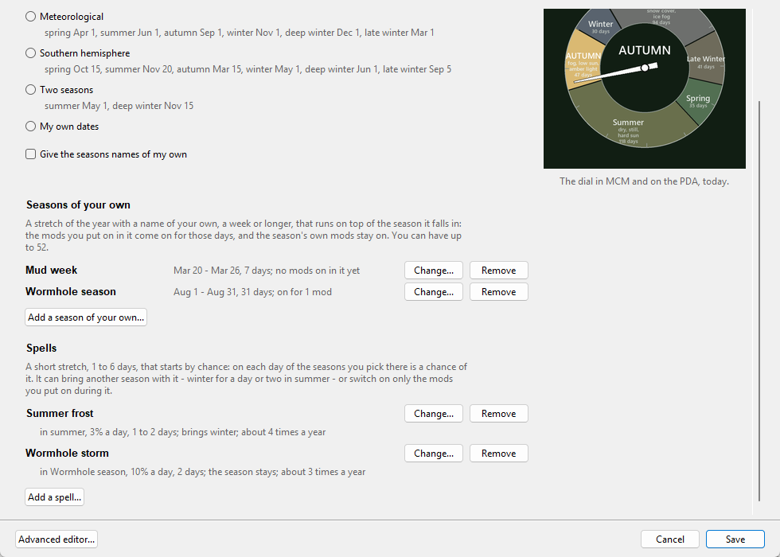
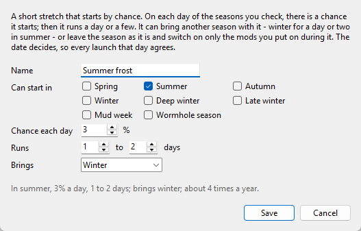
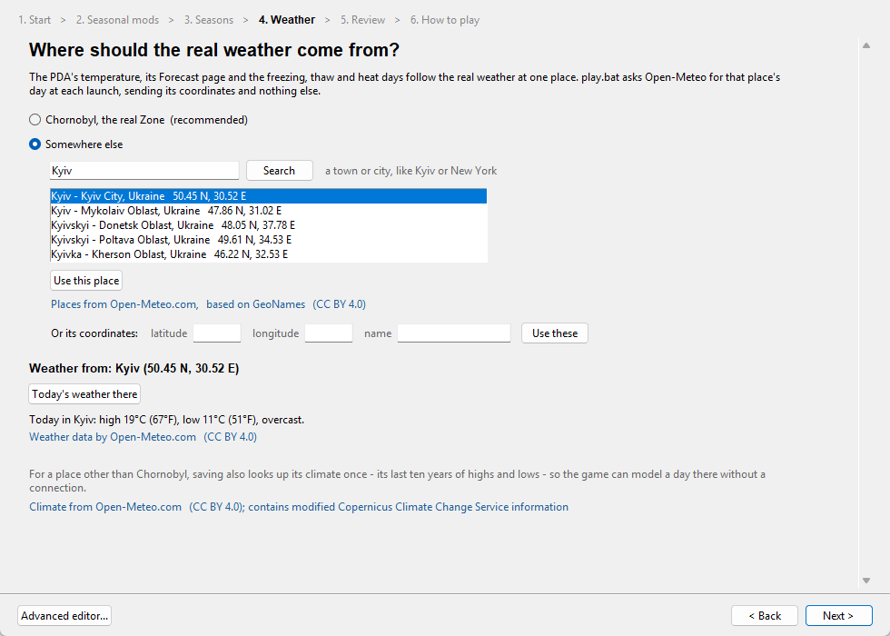

# Configuring seasonal mods

Everything here is optional. With no configuration you get the seasonal atmosphere: light,
color, foliage, fog, wind, wetness, the dial, the MCM pages and the PDA message.

Configuration adds what can't change while the game runs: switching seasonal mods,
swapping texture sets, and gating ambient sound. `_tools\season.py` does that before the
game starts; `play.bat` runs it for you. It also sets where the real weather comes from.

Most setups need no editing by hand. `configure.bat` writes `_tools\seasons_config.py`
for you, and the file stays yours to edit if you would rather; this page is its
reference. `_tools\seasons_config.example.py` is the setup these tools were made on - its
seasonal mods, texture sets and sound - with every table described.

Making a mod seasonal is the common case, but the calendar is open: you can add your own
base periods and overlapping events, and make mods seasonal on those instead. That is
**[docs/SCHEDULING.md](SCHEDULING.md)**.

---

## configure.bat

The first time, open it from the mod's folder: in MO2, right-click the mod, choose **Open
in Explorer**, and double-click `configure.bat` there. It puts `play.bat`,
`configure.bat` and `_tools` in your GAMMA folder, next to `ModOrganizer.exe`, and carries
on from there. After an update, do the same: it updates the tools there and keeps your
setup and the MO2 entry `play.bat` starts.

The setup goes in steps, and nothing is written until the Review step's **Save**:

1. **Start** from what you have set up now, a preset of your own, the GAMMA example, or
   nothing. The GAMMA example is the seasonal mods these tools were made with, for the
   ones you have installed.
2. **Seasonal mods**: a checklist. **Change...** sets when one is on, and under **More
   options** its events, its kinds of weather, and the mod it wins over. **Add another
   mod...** makes any other mod seasonal. Texture sets and the ambient sound are here too.

   **Install one from an archive...** installs a mod you've downloaded into MO2's mods
   folder and makes it seasonal. An installer's options become checkboxes; one that asks
   questions depending on other answers is left to MO2 (Install a new mod from archive),
   after which the mod can be added here. **Add a file...** puts a fix from the mod's
   author where the mod has a file of that name - the CConV1.5.dds that Colorful Autumn's
   author posted goes to its `gamedata\textures\ccon`, say. Archives in your GAMMA and
   downloads folders whose names say a season are listed on the step, with an Install
   button. MO2's mod list isn't touched: MO2 finds the new folder by itself, and `play.bat`
   puts it in the list just above the mod it wins over.

   When a seasonal mod ships files that another seasonal mod on at the same time ships
   too - a recolor and the set it recolors - the setup asks whose the game should use,
   and sets which one wins over the other from the answer.
3. **Seasons**: Polesia's dates, another calendar that comes with the tool, or your own,
   and names of your own, with the year dial as the game will draw it. See
   [`CALENDAR`](#calendar) and [`NAMES`](#names). Below them, **Add a season of your
   own...** and **Add a spell...** make the two things the calendar can add; see
   [`OWN_SEASONS`](#own_seasons) and [`SPELLS`](#spells). A mod is put on in them in its
   **Change...** dialog on the Seasonal mods step: seasons of your own sit with the six,
   spells under **More options**. Last, **The dice**: MCM's switch and chance for rolling
   the season at launch; see [The dice](#the-dice).
4. **Weather**: Chornobyl, or a place you look up. See [`WEATHER_PLACE`](#weather_place).
5. **Review**: the setup in a few lines, and what `play.bat` will switch today. Anything
   `play.bat` would refuse is listed with a **Fix** button that takes you to it.
6. **How to play**: which MO2 entry `play.bat` starts, to change if MO2 names it
   differently.

Once there is a setup, `configure.bat` opens to a summary instead, with a **Change**
button for each part - each saves on its own - **Run the setup again**, **Save as a
preset...**, and **Preview the next launch**, which shows what `play.bat` would switch,
today or in any season.

**Advanced editor...**, on every page, opens the tabbed editor for everything the steps
leave out: making and changing events, and which mod wins over which. It lists your mods
as MO2's left pane does; pick one and check the seasons, events or kinds of weather it
belongs to. Its **Wins over** box names the mod it has to win over - worked out from the
files the two share - and says what else would still win its files. Anything `play.bat`
would refuse shows in red at the top of the window, with a button that takes you to it.
`py _tools\configure.py --advanced` opens it directly.

---

## Commands

Run these in your GAMMA folder. Where they say `py`, use `python` if that is how your
Python starts.

```bash
py _tools\season.py status                 # today's season, what is staged, what is installed
py _tools\season.py apply                  # stage it (what play.bat runs)
py _tools\season.py apply --dry-run        # report what would change
py _tools\season.py apply --season winter  # stage a season other than today's
py _tools\season.py apply --no-textures    # the seasonal atmosphere only, this run
py _tools\season.py whowins <gamedata path> --for "<your mod>"
py _tools\season.py dial                   # hand the calendar and names to the game
```

`status` changes nothing. `apply` does nothing when the staged season already matches the
date. `--mapping met` uses Ukraine's meteorological calendar (round month starts) for one
run; `CALENDAR` is the lasting way to change the dates.

`configure.bat`, as commands (`py _tools\configure.py --help` lists them all):

```bash
py _tools\configure.py list               # the seasonal mods, events and calendar
py _tools\configure.py add "<mod>" --when winter "deep winter" [--above "<mod>"]
py _tools\configure.py remove "<mod>"
py _tools\configure.py event christmas 12-24 12-26
py _tools\configure.py event weekend --weekdays weekends     # a rule; see SCHEDULING.md
py _tools\configure.py event christmas --remove
py _tools\configure.py season                         # your seasons of your own
py _tools\configure.py season "Wormhole season" 08-01 08-31
py _tools\configure.py season "Wormhole season" --rename "Rostok wormhole"
py _tools\configure.py season "Rostok wormhole" --remove
py _tools\configure.py spell                          # your spells, and how often each comes
py _tools\configure.py spell "Summer frost" --in summer --chance 3 --days 1 2 --as winter
py _tools\configure.py spell "Summer frost" --chance 2          # change one part
py _tools\configure.py spell "Summer frost" --remove
py _tools\configure.py dice                           # MCM's dice: on or off, and the chance
py _tools\configure.py dice on --chance 40            # roll at 40% a launch; 100 rolls every one
py _tools\configure.py dice off
py _tools\configure.py mcm                            # MCM settings that follow the season
py _tools\configure.py mcm --find winter              # MCM's options, by a word of the name
py _tools\configure.py mcm cold_system/winter --in winter "deep winter" --to true --else false
py _tools\configure.py mcm cold_system/wind --set "deep winter=2" winter=1.5 --else 1
py _tools\configure.py mcm cold_system/wind --remove
py _tools\configure.py calendar           # when each season starts, and which are off
py _tools\configure.py calendar summer=5-1 "deep winter=11-15" [--only]
py _tools\configure.py calendar --off "late winter"
py _tools\configure.py calendar --on "late winter"    # back on, at Polesia's date
py _tools\configure.py calendar --dates met           # the meteorological dates
py _tools\configure.py calendar --reset               # Polesia's again
py _tools\configure.py name                           # what each season is called
py _tools\configure.py name "deep winter" "The Long Cold"
py _tools\configure.py name "deep winter" --reset
py _tools\configure.py place                          # where the weather comes from
py _tools\configure.py place "Kyiv" [--pick 2]        # look a place up and use it
py _tools\configure.py place --at 50.45 30.52 --name Kyiv
py _tools\configure.py place --reset                  # Chornobyl again
py _tools\configure.py lut                            # each season's LUT, and the LUTs found
py _tools\configure.py lut winter Iris 60             # 60% of the way to Iris
py _tools\configure.py lut winter --off
py _tools\configure.py preset                         # the presets there are
py _tools\configure.py preset show "Two seasons"
py _tools\configure.py preset load "Two seasons" [--parts calendar] [--force]
py _tools\configure.py preset save "Mine" [--about "..."] [--parts calendar mods]
```

`add` makes a mod seasonal, or replaces when it is on if it already is. The name is
checked against MO2's mod list, with suggestions for a near miss; a name with a space goes
in quotes. `--when` takes seasons as MCM shows them, your own names for them, or as the
config spells them, and any season of your own, spell, event, period or kind of weather.
Without `--above`, the mod
it wins over is the highest enabled mod that ships any of the same files; when another
seasonal mod on in the same season shares files, `add` names it and leaves the choice to
you.

Every save checks the result with `season.py`'s own rules first, keeps the previous file
as `seasons_config.py.bak`, and rewrites only the entries that changed, so comments and
anything written by hand stay as they were. A save that can't keep every comment - one
inside a table written on a single line, say - also keeps a dated copy that no later save
touches, and says where. The tool refuses rather than guess: a file saved in an encoding it
would have to mangle, a table sharing its line with another statement, a table the lines
below it change again, or a file that changed since it was opened is left as it is, with a
message saying what to do.

**Undoing a save:** `seasons_config.py.bak`, next to it in `_tools`, is the file as it was
before the last save. Close `configure.bat`, delete `seasons_config.py` and rename the
`.bak` to `seasons_config.py`.

---

## The seasons, as each place spells them

| In MCM, the PDA and the window | In the config | In commands |
|---|---|---|
| Spring | `spring` | `spring` |
| Summer | `summer` | `summer` |
| Autumn | `autumn` | `autumn` or `fall` |
| Winter | `winter` | `winter` |
| Deep winter | `winter_snow` | `"deep winter"` or `winter_snow` |
| Late winter | `late_winter` | `"late winter"` or `late_winter` |

A name of your own for a season (see [`NAMES`](#names)) works in commands too. The config
keeps the keys either way.

---

## `TOGGLE_MODS`

The seasonal mods. Each is enabled in the seasons, events and weather it lists, and
disabled the rest of the year. Nothing is copied; MO2 stops mounting the folder. Prefer
this to `LAYOUT`.

```python
TOGGLE_MODS = {
    "INVERNO Winter Textures (seasonal)": {        # folder name, exactly as MO2 shows it
        "when": ("winter", "winter_snow", "late_winter"),
        "above": "388- Aydins Grass Tweaks SSS Terrain LOD Compatibility - aytabag",
    },
}
```

| Field | Meaning |
|---|---|
| *key* | The mod folder name under `mods/`. A folder that is not installed is skipped. |
| `when` | When the mod is enabled: any mix of seasons (`spring`, `summer`, `autumn`, `winter`, `winter_snow`, `late_winter`), your events and periods, and the kinds of weather `freezing`, `thaw` and `heat`. One name needs the trailing comma: `("winter",)`. `seasons` is the original spelling of this key and still works. |
| `above` | The mod this one wins over. `play.bat` keeps it just above that mod in `modlist.txt` - just below it in MO2's left pane - so where both ship a file, this one's is used. `configure.bat` picks it for you. |
| `save_content` | `True` lets `play.bat` switch a mod whose files put things into saves; see [What a mod leaves in saves](#what-a-mod-leaves-in-saves-save_content). Without it, such a mod is left as it is in MO2. Written by hand. |

The weather comes from the real forecast `play.bat` fetches at each launch, for the place
set in `configure.bat`: `freezing` is a day whose low is 0°C or below, `thaw` one that also
climbs above 0°C by afternoon, and `heat` one whose high reaches 28°C. Like an event, a
weather day is added to whatever season is running. A launch without a connection uses
the forecast the last fetch kept, 16 days of it; past that, none of them is on.

Each seasonal mod gets its own checkbox on the MCM page of every season it is on in, with
its file count and size. Unchecking it there means "never mount this in that season"; the
same mod can stay on for another season.

### What a mod leaves in saves (`save_content`)

Switching a mod off is safe for one that changes how the Zone looks and sounds: textures,
shaders, grass, weather. A save keeps each object in it by its section's name, so a mod
that adds items leaves them in the saves made while it is on. Once `play.bat` turns it off,
those sections are gone:

- current Modded Exes delete the mod's items from a save as it loads; they are lost;
- exes from before July 2023 crash loading such a save;
- a save made with an item of the mod's on a quick-use slot stops loading with
  `Can't open section`: each save keeps its own slots, and the HUD looks the item up as
  the save comes up.

So before switching a seasonal mod, `play.bat` looks through its files for:

| What | Found by |
|---|---|
| Items and other objects | an `.ltx` in `configs/` with a section that has `$spawn`, or an inventory key (`inv_...`) and a class, its own or a parent's. DLTX's `![...]` and `!![...]` change or delete another file's section, so they don't count. |
| Traders' stock | `configs/items/trade/`, or `trade` as a word in an `.ltx`'s name |
| Loadouts, a new game's or NPCs' | `loadout` or `loadouts` as a word in an `.ltx`'s name |
| Spawns | `spawns/`, or a `.spawn` |
| Scripts that create objects | `alife():create` and the rest of its family, on `alife()` or a name it is kept in, and `alife_create`, `alife_create_item`, `alife_clone_weapon`, `create_ammo`, `create_squad`, `spawn_item`, `buy_supplies`. Comments, strings and a function's own definition don't count. |
| `.db` archives in `db/` | a script, config or spawn in one, by its file list; a `.db` whose list can't be read counts too |

A mod with any of these is left as it is in MO2, on or off, with a `!` line naming the
files in `play.bat` and `season.py status`. Its MCM checkbox goes, since unchecking it would
do nothing. `configure.py add`, `list`, and both windows say so for that mod. To switch it
anyway, add the key to its entry by hand:

```python
    "My Winter Mod": {
        "when": ("winter", "winter_snow"),
        "above": "...",
        "save_content": True,       # its items stay in my saves; I switch it knowing that
    },
```

The tools keep it when they change the entry; a preset never brings one. The check reads
the mod's files, not the game's, so a mod that ships a whole copy of a game file - a
weapon or creature config, say - counts too, though the game has those sections without
it. If that is all it is, allow it. What the check can't see is yours to judge: locations,
quest lines, tasks and dialogs can leave a save needing a mod as well.

**After a mod with items went off:**

- *A save stops loading with `Can't open section` and an item of that mod.* That save has
  the item on a quick-use slot. Load it with the mod on (enable it in MO2 and start from
  MO2, since `play.bat` would switch it off again), put something else on that slot, and
  save. Editing `user.ltx` doesn't help: a save puts its own slots back as it loads.
- *A save loads without the mod's items.* They were deleted as it loaded; don't save over
  it. To have them back, load it with the mod on: enable the mod in MO2 and start from MO2,
  since `play.bat` would switch it off again, or wait for its season.
- *A save crashes as it loads, older exes.* Load it with the mod on, as above.

### Particles a script makes as a save loads

The game loads every script in `gamedata\scripts` as a game starts. A script that calls
`particles_object()` outside its functions makes those particles then, and a particle the
game doesn't have is a crash no script can catch: `Particle effect or group doesn't exist`.
INVERNO 1.09's snowfall is such a script. So once the season is staged, `play.bat` reads
the scripts the game will load for particles that only mods off for this launch have, and
stops before the launch:

```
  ! Inverno_snowfall_system.script, in "Project INVERNO mechanics (update)", makes 7
    particle effects as a save loads that only mods off for this launch have: graupel\dust,
    graupel\snowflakes, graupel\snow_light_left and 4 more. The game crashes on the first
    ("Particle effect or group doesn't exist").
    Copy gamedata\particles from "INVERNO (seasonal)" into "Project INVERNO mechanics
    (update)", the mod with the script, so the game has them whenever it loads the script.
```

A particle is there when it is a loose `.pe` or `.pg` under `gamedata\particles` in a mod
that is on or in MO2's overwrite, in a `.db` of a mod that is on, or in the `particles.xr`
that wins. With no loose `particles.xr`, the game's own, inside its `.db` archives, may
have it, so the line starts with `-` and the launch goes ahead. `season.py status` shows
the same lines. A particle a script makes inside a function, once it runs, isn't checked.

The textures those particles draw with are looked for too. A texture the game can't find
crashes nothing, but the particles draw as squares where they play, so `play.bat` warns
and launches:

```
  - Inverno_snowfall_system.script, in "Project INVERNO mechanics (update)", makes
    particles as a save loads that draw with 6 textures the game won't find in this
    launch: grpl\pfx_smoke_a, grpl\pfx_yawm_flake_grid, grpl\pfx_yawm_snowflakes_light
    and 3 more. Where they play, the game draws squares.
    Copy db\addons\inverno_textures.db from "INVERNO (seasonal)", off for this launch,
    to the same place in "Project INVERNO mechanics (update)", the mod with the script.
```

A texture is there when it is loose under `gamedata\textures` in a mod that is on, in MO2's
overwrite or in the game's folder, or in a `.db` of a mod that is on or of the game. The
particles are read from their loose `.pe` and `.pg` files; those of a `particles.xr` come
with their own textures and aren't. When no mod has a texture, the line says so: it comes
with the mod the particles are from. When a `.db` it would look in can't be read, it says
nothing, since that one may have them.

### Which mod it wins over (`above`)

MO2 gives a shared file to the enabled mod with the highest priority that ships it: the
one lowest in its left pane. If a mod that wins over yours ships the same file, yours loses
and nothing tells you. `configure.bat` works the right `above` out from the files the mods
share. To check by hand, pick a file your mod ships and ask, naming your mod with `--for`:

```bash
py _tools\season.py whowins textures/map/map_escape.dds --for "Winter PDA Maps (seasonal)"
```

```
  file: gamedata/textures/map/map_escape.dds

    line   190  disabled  Winter PDA Maps (seasonal)             2097280 B   <-- yours
    line   539  enabled   358- Global Map Rework - DeadEnvoy     8388736 B   <-- yours has to win over this one
    line   862  enabled   26- High Res PDA Maps - Bazingarrey    8388736 B

  Make Winter PDA Maps (seasonal) win over:  358- Global Map Rework - DeadEnvoy
  In the config:  "above": "358- Global Map Rework - DeadEnvoy"   (in configure.bat: its Wins over box)
```

`--for` keeps your mod out of the answer. Without it, the top enabled mod is named, and
the one under it too, in case the top one is yours: MO2 puts a fresh install at the top.
If no mod ships the file, any position works.

Placement is checked on every run. If the mod it wins over is no longer in MO2's mod list
(GAMMA renumbers folders between versions), that entry is skipped with a warning and the
others still run.

`above` only keeps a mod just above that one mod. `season.py status` also checks every file
of every seasonal mod against every other mod, in the order `apply` leaves them, and
reports:

- `! <mod> loses N files to "<other>"` — an enabled mod still wins some of its files. In
  `configure.bat`, make it win over that mod, or disable that mod.
- `- N disabled mods in MO2 would win some of <mod>'s files if enabled` — nothing wrong
  yet; check again after enabling one.
- `- "<other>" wins N of <mod>'s files in <seasons>` — two seasonal mods on in the same
  season share files, and the one listed wins. Fine if that is the intent.

`play.bat` runs the same check whenever MO2's mod list has changed.

---

## `LAYOUT`

Texture sets: for mods that ship one folder per season inside one archive, such as Aydin's
Grass Tweaks.

```python
LAYOUT = {
    "289- Grass Tweaks (reinstall for different options) - Aydin": {
        "archive": "Aydins_Grass_Tweaks_4.0.7z",     # filename in MO2's downloads folder
        "options": {
            "spring": ["Aydin's Grass Tweaks - SPRING 4.0",
                       "Aydin's Grass Tweaks - SPRING TREES 4.0"],
            "summer": ["Aydin's Grass Tweaks - SUMMER 3.0", ...],
            ...
        },
    },
}
```

| Field | Meaning |
|---|---|
| *key* | The installed mod folder whose contents are replaced. |
| `archive` | Filename in `downloads/`. A `.7z` needs the py7zr package, a `.rar` the rarfile package plus WinRAR or 7-Zip; the setup offers to install either package. |
| `options` | Season → folder names inside the archive, applied in order (later ones win). |

Gigabytes are copied on a season change, so use `TOGGLE_MODS` wherever a mod can be
switched off instead. A season with no entry keeps whatever is already staged. An archive
that is missing from `downloads/` skips that texture set with a warning; the rest of the
launch goes on.

What is installed is identified by hashing the folder against the archive's options, so a
correct season is never re-copied. The archive-side hashes are cached after the first run.

---

## `SOUND_SRC`

```python
SOUND_SRC = "304- Dark Signal Weather and Ambiance Audio - Shrike"
```

Name the mod that wins your `configs/environment/ambients/presets/` files (several
soundscape mods ship the same presets). `py _tools\configure.py sound` lists the enabled
mods that have them, highest in MO2 first, and `configure.py sound "<mod>"` sets this line
for you; `sound --off` sets it to `None`. In `configure.bat`, the list beside **Ambient
sound follows the season** does the same, and the box turns it off. `season.py` generates a `Seasonal Soundscape` mod
from that mod's files with these channels removed:

| Season | Silenced |
|---|---|
| spring | night crickets |
| summer | nothing |
| autumn | daytime insects, swamp birds |
| winter | all insects, swamp birds, leaf rustle |
| deep winter | all insects, swamp birds, daytime birds, leaf rustle |
| late winter | all insects, leaf rustle |

Wind, storms, thunder and interiors are never touched. Crows and owls stay all year.
Crickets belong to summer and autumn nights, so spring is carried by the dawn chorus
alone; autumn keeps them calling until the first frost but loses the daytime insects.
The thaw brings the marsh birds back before any insect stirs, or any leaf opens.

The channel names are both packs' by Shrike: Dark Signal Weather and Ambiance Audio's
`Insects` and `Insects_night`, and Dark Signal Amplified Soundscape's `bugs_day`,
`bugs_night` and `bugs_swamp`, with its leaf rustle (`Foliage`, `foliage_lite`,
`tree_lush`, `tree_small`). Gusts through the trees and branch snaps are wood and wind, and
stay. A name a pack doesn't use cuts nothing in it.

The generated files record the source and the channels they were cut with, so changing
either rebuilds them at the next launch rather than waiting for the season to turn.

A soundscape pack installed above the source wins its files back, since the generated mod
sits directly above the source: the seasons then stop reaching those places, which shows
nowhere in the game. `season.py status` names such a pack, how many of the files it wins,
and how to make it the source: in `configure.bat`, or with `configure.py sound`.
`configure.bat` says so under the list too.

The generated mod is placed just above `SOUND_SRC` and follows the MCM switch; you do not
touch it in MO2. If you disable the source mod, the generated presets are removed at the
next launch. Leave `SOUND_SRC = None` to skip the layer.

---

## No Rain in Winter

```bash
py _tools\configure.py rain           # the weathers that rain, by the mod MO2 takes each from
py _tools\configure.py rain --build   # make the mod, and put it on the calendar
py _tools\configure.py rain --off     # take it off the calendar, and disable it in MO2
```

A weather's rain is its `rain_density`, set hour by hour in its file under
`configs/environment/weathers/`. It makes the engine draw rain, play its sound and wet the
ground, and no script can change it, so the snowfall layer snows into rain. `rain --build`
makes a mod, `No Rain in Winter (seasonal)`, of copies of every installed weather that
rains at any hour, each from the mod MO2 takes it from, with every `rain_density` set to 0
and nothing else changed. It goes into `TOGGLE_MODS` for winter and deep winter, above the
highest mod with a weather it copies. Late winter, the thaw, keeps its rain; `add` changes
when it is on, as for any seasonal mod, and a later `rain --build` keeps that.

`configure.bat`'s Seasonal mods step has the same switch, **Snow, not rain**, under *Rain in
the winters*; the step's list of seasonal mods leaves the mod out. Ticked and saved, it goes
on the calendar and the copies are made, as `rain --build` does; with MO2 or the game open,
`play.bat` makes them at the next launch instead. Unticked and saved, it comes off the
calendar and is disabled in MO2; with MO2 open, which would write its list over that, the
window says to uncheck it there.

Each copy's first line names the mod it came from and that file's SHA-256. When one of them
changes, as an Atmospherics update changes them, or a weather pack is added or disabled,
`play.bat` makes the mod again before switching it, and `season.py status` says it is out
of date. A pack added above the mods it copies is won over from the next launch, with a
line saying to run `rain --build` to keep it so. A weather in MO2's overwrite folder wins
over every mod and rains all the same; `rain` says so. DLTX can't do this: the game loads
every `.ltx` in the weathers folder as a weather of its own.

**Rain for gameplay (2.7.1).** Scripts read the rain with `level.rain_factor()`, and with the
rain taken out it reads 0. So each copy keeps what it had, as `sotz_rain_density` on the line
under each zeroed `rain_density`; the engine never reads that key. At each load Seasons of
the Zone gives a `level` of their own to the scripts that use rain for gameplay, and their
`rain_factor()` reads it back, blended across the hour: `xr_combat_ignore` (NPCs see less far
in a storm), `arti_jamming` (rain jams guns), `bind_campfire`, `xr_conditions` (the AI's rain
conditions), Stealth Overhaul Reworked's `stealth_noise` and `visual_memory_manager`, and
REDone Combat AI's `redone_ai_detection`. A script that keeps `level` in a local of its own,
as REDone Combat AI's do (ROMEO ships it), has that local given the same `level`; the log
warns if the game named a script's functions in a way that hides them.
Useful Idiots replaces `xr_combat_ignore`'s enemy check with its own, loaded with `require`,
so the functions of `illish.patches.xr_combat_ignore` get that `level` too; in GAMMA, NPC
sight goes by that one. A script whose loose file never mentions `rain_factor` is left
alone, since another mod's copy of the same name may not read rain. The log says which it
reached ("rain for gameplay through: ..."). Everything else, the engine included, still
sees no rain, so rain's sound, puddles and drops stay off. Immersive Identification's
weather takes `level` from `_G` itself, and reads the dry value. A copy made by 2.7.0 has
no kept rain; `play.bat` makes it again.

---

## `CALENDAR`

```python
CALENDAR = {
    "summer": (5, 1),            # (month, day) the season starts
    "winter_snow": (11, 15),
}
```

The seasons that are on and the day each starts. `configure.bat`'s Seasons step writes it,
and `configure.py calendar` does from a command prompt. Each season runs until the next one
that is on, so a season left out gives its days to the one before it; the example is
summer from May 1 and deep winter from November 15, and nothing else. `None`, or no
`CALENDAR` at all, is Polesia's six.

Every season needs at least 14 days, no two can start on the same day, and none can start
on February 29, which three years in four do not have. At least one has to be on.

A mod on only in seasons that are off is never switched on; `season.py status` names it. An
MCM pin on a season that is off counts as automatic.

`play.bat` hands the calendar to the game in `configs/season_calendar.ltx`, and saving from
the tool does too, so the seasonal atmosphere follows it from the next start even without
`play.bat`. MCM shows a page and a pin for each season that is on.

The year dial is redrawn for your dates, 32 images in the mod's `textures/` folder. That
needs Pillow, a Python package: `py -m pip install pillow`, which the tool offers to run.
Without Pillow the dial is hidden, since the shipped one shows Polesia's dates.
`season.py dial` draws it by hand, and a return to Polesia's calendar deletes it.

---

## `NAMES`

```python
NAMES = {
    "winter_snow": "The Long Cold",
    "late_winter": "Rasputitsa",
}
```

Names of your own for the seasons. The game shows them wherever it names a season: the PDA,
the messages when a season turns, MCM's page titles and the Season list, and the year
dial, which is redrawn with them as for a calendar of your own. The config keeps the
usual keys, so `when`, `LAYOUT` and everything else still say `winter_snow`.

A name is up to 20 letters, English or Cyrillic, which is what the game can show; two
seasons can't share one. `None`, or a name left as the usual one, keeps the usual name.

---

## `OWN_SEASONS`

```python
OWN_SEASONS = {
    "Wormhole season": ((8, 1), (8, 31)),
    "Mud week": ((3, 20), (3, 26)),
}
```

Seasons of your own: a name, and the first and last day, both counted. Each runs on top of
the season it falls in, as an event does - the mods on in it come on for its days, and the
season's own mods stay on - so it doesn't cut into the calendar. A window whose first day
comes after its last runs across the new year.

- A season of your own runs **at least a week**; a shorter stretch is an event.
- There can be **up to 52**, one for each week of the year.
- A name is up to 24 characters and can't be a season's, an event's, a period's or a kind
  of weather's, in any capitals. It can have spaces: `"Wormhole season"` is fine.
- February 29 can't be a first or last day.

`configure.bat`'s Seasons step makes them, and so does `configure.py season`. Taking one
off takes it off every mod on in it; a mod on in nothing else comes off the calendar, and
the window asks first.

 Renaming one renames it for its mods too. They are not on the dial
or the MCM pages, and `status` names the ones on today on its `also today` line.

---

## `SPELLS`

```python
SPELLS = {
    "Summer frost": {"in": ("summer",), "chance": 3, "days": (1, 2), "as": "winter"},
    "Wormhole storm": {"in": ("Wormhole season",), "chance": 10, "days": 2, "as": None},
}
```

A spell is a short stretch that starts by chance. See
[SCHEDULING.md](SCHEDULING.md#seasons-of-your-own-and-spells) for how it is decided.

| Part | Meaning |
|---|---|
| `in` | The seasons it can start in: the six, as the config spells them, and yours. Seasons off in your calendar don't count. |
| `chance` | The percent chance it starts on each of those days, more than 0 and up to 100. Decimals are fine: `0.5`. |
| `days` | How long it runs: a number, or the fewest and the most, `(1, 2)`. 1 to 6; a week or longer is a season of your own. |
| `as` | The season it brings, which has to be on in your calendar, or `None` to leave the season as it is. |

A spell that brings a season makes it the season for as long as it lasts: `play.bat` stages
that season's mods, texture sets and sound, and writes the spell into the file the game
reads, so the light and the weather follow it until its last day, and the PDA's message as
the game loads, the PDA's Year page and the MCM page name it. The Year page tints the
spell's days that season's color, and lists the spells that can start today with their
chance a day, never their dates. An MCM pin wins over a spell. The mods on during a spell
come on whether it brings a season or not.

The Seasons step's **Add a spell...** shows how often a spell comes on average as you set
it - 3% a day in Polesia's summer is about 3 a year - and `configure.py spell` lists each
one that way.

 `status` shows a spell on today on its `season` line.

---

## The dice

The dice aren't in `seasons_config.py`. They are two of MCM's own options on the mod's Main
page, **Roll the season at launch** and **Chance per launch**, which the Seasons step, the
advanced editor's Seasons tab and `configure.py dice` set in MCM's file, so the game's page
shows the same. The tools won't set them while the game runs, since it saves its own MCM
settings over them as it closes; set them on the MCM page then.

At each launch, `play.bat` draws a whole number from 1 to 100. At or under the chance, the
dice hit: another of the seasons your calendar has on, picked at random, runs until the
next launch, as an MCM pin would - its mods, texture sets and sound, the light and the
weather, the PDA's message as the game loads, and MCM's Main page. Over the chance, the
calendar's season runs, or a spell's. A pinned season, or one forced with `--season`, is
never rolled over. Unlike a spell's, the draw is new at every launch, so two launches on
the same day can differ.

`play.bat`'s report gives the draw: on the `season` line for a hit, on a `dice` line for
a miss. `status` and `--dry-run` give the chance and roll nothing.

---

## Grass by the season

The grass isn't in `seasons_config.py` either. Each season's MCM page has **Grass this
season (%)**, from 20 to 100, and the Main page has **Grass follows the season**, on by
default. `play.bat` reads them from MCM's file at each launch.

The game spaces its grass by `r__detail_density` in `appdata\user.ltx`, the **Grass
Density** slider of its advanced video options. Each 2 m patch of ground has a grid of places for
grass, 2 ÷ density rounded up, plus one, along each side, so a higher value means less
grass, in steps. A level reads the value as it loads, so before the game starts `play.bat`
sets it to the step nearest the season's share of your grass. It never sets a value under
yours, so the grass is never denser than you have it. At GAMMA's 0.25 the steps are 100,
79, 60, 44, 31 and 20 percent:

| | spring | summer | autumn | winter | deep winter | late winter |
|---|---|---|---|---|---|---|
| Default share | 80 | 100 | 100 | 60 | 40 | 60 |
| At 0.25, set to | 0.29 | 0.25 | 0.25 | 0.34 | 0.4 | 0.34 |
| Share it gives | 79 | 100 | 100 | 60 | 44 | 60 |

`status` and the `grass` line of `play.bat`'s report give the share and the value. A
period, event or season of your own that is staged in place of the six keeps all your grass.

Your own value is what `user.ltx` held before `play.bat` first set it.
`_baseline\season-grass.json` keeps it and the value written; a value `play.bat` didn't
write, such as one you set with the slider, becomes your own from the next launch. With the
switch off, the next launch puts your value back once, then leaves the line alone. Only that
line changes, and the file is kept as it was in `_baseline\modfile-backups` first, the
newest ten. Nothing is written while the game runs, since it saves `user.ltx` as it closes.

Grass height and draw distance stay as you set them. GAMMA's height, 0.5, is already the
game's lowest.

---

## `MCM_SETTINGS`

```python
MCM_SETTINGS = {
    "cold_system/winter": {"winter": True, "winter_snow": True, "late_winter": True,
                           "freezing": True, "else": False},
    "cold_system/wind": {"winter_snow": 2.0, "winter": 1.5, "else": 1.0},
}
```

Another mod's options in MCM that follow the season, for a mod that stays on all year.
Before the game starts, `play.bat` sets each in MCM's saved options,
`axr_options.ltx`, to its value for what is on that day, or to `"else"` when none of its
names is. The mod reads it from MCM as it always does, and needs to know nothing about
this one.

| Part | Meaning |
|---|---|
| *key* | The option as MCM saves it: its page and the option, with `/` between, like `cold_system/winter`. `configure.py mcm --find <word>` lists them, and the Seasonal mods step's **Add an MCM setting...** finds one by a word of its name. This mod's own options can't be here. |
| *a name* | A season, event, period, season of your own, spell or kind of weather, as `when` takes them, and the option's value then. |
| `else` | Its value the rest of the year. Needed. |

A value is `True` or `False` for a checkbox, a number, or text in quotes, the same kind
throughout. When more than one of its names is on, the most specific wins: a kind of
weather, then a spell, an event, a season of your own, and last the season or period; of
two alike, the first listed.

`status` shows each option's value for today and what MCM has now. `play.bat` changes only
the lines of options that need it, keeping the rest of the file as it was, and keeps the
file as it was first in `_baseline\modfile-backups`, the newest ten. It doesn't write
while the game is running, since MCM saves its own values as the game closes. A change
made in MCM lasts until the next launch. Removing a setting leaves the option at the value
it has then.

---

## `WEATHER_PLACE`

```python
WEATHER_PLACE = {"name": "Kyiv", "lat": 50.4547, "lon": 30.5238}
```

Where the real weather comes from: the PDA's temperature, its Forecast page, and the
`freezing`, `thaw` and `heat` days. `None`, or no `WEATHER_PLACE` at all, is Chornobyl.
`configure.bat`'s Weather step writes it - search for a town, or give its coordinates -
and `configure.py place` does from a command prompt. The seasons don't move with it: a
place in the southern hemisphere wants the Southern hemisphere preset, or a calendar of its
own.



| Field | Meaning |
|---|---|
| `name` | What the PDA calls it, up to 24 characters. Letters the game can't show lose their accents there: São Paulo reads Sao Paulo. |
| `lat` | Latitude in degrees, -90 to 90, north positive. |
| `lon` | Longitude in degrees, -180 to 180, east positive. |

At each launch `play.bat` asks [Open-Meteo](https://open-meteo.com/) for the day's high and
low there and the 15 days after, sending the coordinates and nothing else. The game reads
each day from those while they last, so a launch from MO2, or without a connection, still
has the real weather that far ahead. For a place other than Chornobyl, the first fetch
also asks once for its last ten years of daily highs and lows, so the game can model any
day there when the forecast runs out; Chornobyl's are built in. The search on the Weather
tab sends what you type to Open-Meteo's place search. A preset never holds the place.

The weather data is by Open-Meteo.com, under
[CC BY 4.0](https://creativecommons.org/licenses/by/4.0/); the place search is based on
[GeoNames](https://www.geonames.org/) (CC BY 4.0), and the climate history contains
modified Copernicus Climate Change Service information (ERA5). The PDA, `configure.bat` and
`play.bat` credit it where they show it. The game moves the day's temperature with its own
sky, so the numbers on the PDA are Open-Meteo's endpoints, changed.

---

## W.P.W.M.'s level weather

W.P.W.M., the weather manager that comes with Atmospherics, can give each level weather of
its own: in MCM, **W.P.W.M** > **Levels**, **Enable Level Weather**, off by default. With
**Weather odds follow the season** on Seasons' Main page, the season tilts W.P.W.M.'s
weights, and a level's setting scales those, so the tilt carries through: a level set to
**Rain Dominant** still sees more rain in autumn than in summer. Two kinds of setting take
the season out of it:

- **Always Sunny** and the other **Always** settings hold that sky on the level in every
  season.
- A setting that leaves a sky out, like **No Clear Weather** or **Rain and Storm Only**,
  leaves it out in every season.

On Seasons' marked days the held sky wins anyway: if **Switch Weather on Arrival** moves a
level off a remembrance day's clear sky or an anniversary's storm, Seasons sets it back
within seconds.

---

## Presets

A preset keeps a setup under a name, in `_tools\presets\`, as a JSON file: plain data, so
one posted by someone else can be loaded without running anything they wrote. It holds any
of four parts:

| Part | What it is |
|---|---|
| calendar | `CALENDAR` and `NAMES` |
| events | `OWN_SEASONS`, `SPELLS`, `EVENTS` and `PERIODS` |
| mods | `TOGGLE_MODS` and `MCM_SETTINGS` |
| textures | `LAYOUT` and `SOUND_SRC` |

**Save preset...** in the window, or `configure.py preset save`, keeps the parts that have
something in them, unless you pick others. **Load preset...** shows what each part would
replace before you load it, then sets the parts you choose in place of yours; like any
change in the window it is written only when you save. `configure.py preset load` saves
at once, so it refuses to replace anything of yours unless you add `--force`. A preset made
on another install loads here: a mod you don't have is left out, a mod whose `above` you
don't have gets another for your list, a texture set whose archive is not in your
`downloads/` is left out, and loading says which. A mod on in something your setup doesn't
have - a season of your own, a spell, an event or a period - brings it along from the
preset, and a preset of the mods alone carries those for them. Every part goes through the
same rules as a save, and a preset that would break the config is refused whole.

Four calendars come with the tool: Polesia, Meteorological, Two seasons and Southern
hemisphere. The GAMMA example holds the seasonal mods, events, texture sets and sound
source these tools were made on; its texture sets need `py7zr`, and a mod you have renamed
is left out. A preset of the same name as one that comes with the tool can't be saved over
it.

---

## Color grade presets

The mod ships its season grades as `cfg_load` presets, `Seasons_*.ltx`, in
`gamedata/configs/seasons_presets/`. `play.bat` copies them into the game's `appdata/`
if they are not there, beside Atmospherics' `Atmos_*.ltx`; an existing copy is never
overwritten, so you can tune them in place. Which color grade preset a season uses is
chosen under **Color grade preset** on that season's MCM page, not here; the Seasons tab
and the guided setup say so under *The look of each season*.

---

## `SEASON_LUTS`

```python
SEASON_LUTS = {
    "autumn": ("Kumo Cinegraphy Vol 1.7z", "00 data/EASTMAN", 30),
    "winter": ("Kumo LUT Assortment.7z", "00 data/LUT - Iris", 60),
}
```

Each entry moves a season's color grade from the LUT the game has today toward a LUT
from a pack you downloaded: `(source, option, percent)`. The source is an archive in
MO2's downloads folder, or a mod's folder in MO2, on or off. The option is the folder in
it that holds `gamedata`, as a FOMOD lays out its choices, or `None` when `gamedata` is
at the top. The percent, 1 to 100, is how far the grade moves; 100 is the pack's LUT as
it is. A season left out keeps the game's LUT.

`configure.bat` writes the table: on the advanced editor's Seasons tab, *The look of each
season* has a LUT and a percent for each season, from every LUT it finds, and **Look for
LUT packs again** looks again. The guided setup's seasons step has no LUTs; its **LUTs and
accents...** opens the editor there. As commands:

```bash
py _tools\configure.py lut                      # each season's LUT, and the LUTs found
py _tools\configure.py lut winter Iris 60       # 60% of the way to Iris; 50 if left out
py _tools\configure.py lut winter Iris --from "Kumo LUT Assortment.7z"  # when two packs have one
py _tools\configure.py lut winter --off         # winter keeps the game's LUT
py _tools\configure.py lut --off                # every season does
```

A LUT is named by its option folder, or its archive or mod, without a leading `LUT - `.
Only a pack's `textures\shaders\lut_atlas.dds` is read, and it has to hold one LUT: a
4096 × 64 atlas, uncompressed, 8 bits a color, as Kumo's and Forester's are. A `.7z`
needs py7zr, and a `.rar` rarfile with WinRAR or 7-Zip; without them, the list says how
many archives it couldn't look in, and what to install.

At launch `play.bat` builds a mod called `Seasonal LUT` from the table, and builds it
again whenever an entry, a pack or the game's LUT changes:

- an atlas holding the game's LUTs as they are, then, for each season with a LUT, its mix
  with each LUT the levels use;
- Screen Space Shaders' LUT header, with room for them all and the crossfade between two
  switched on;
- `configs\seasons_lut.ltx`, which tells the game which LUT is which.

The game's LUTs are those of the enabled mod highest in MO2 that has one, and the levels
use the ones its `scripts\ssfx_lut.script` names. G.A.M.M.A.'s own Atmospherics has 17,
saved as a PNG under the `.dds` name, and its levels use five: one outdoors, one
underground, and one each for Limansk, the Hospital and the levels it doesn't list.
Atmospherics 2.69 has one, for every level. Each mix adds a megabyte to the atlas.

`Seasonal LUT` goes just above that mod, on, and the `LUTs` line of the report names each
season's LUT, and says when it is to be built. Nothing is built while MO2 or the game
runs. With no entries, or with a `!` line naming a pack that is gone, the mod is turned
off at the next launch, and an `ssfx_lut` left in `user.ltx` on a group the game's atlas
lacks is put back on its first.

In the game, `sotz_lut.script` reads the level's own LUT from `ssfx_lut` a second after
Atmospherics sets it as the level loads, and sets the season's mix of it, crossfading
between the blend's two heaviest seasons across a turn, as the other layers do. A season
with no LUT keeps the level's, and the intensity stays as Atmospherics has it. **The
season's LUT** on MCM's Main page, off, holds each level's own. A LUT mod you install
becomes the game's LUT at the next launch: the seasons are built on it, and `Seasonal
LUT` moves above it.

## `SEASON_ACCENTS`

```python
SEASON_ACCENTS = True
```

Accents are small color changes built into each season's LUT, on top of its pack's LUT or
the game's: more color in spring's new leaves, more contrast under summer's high sun,
richer reds and golds in autumn, less color and a cooler middle in winter, crisp
blue-white snow in deep winter, and an earthy, duller thaw in late winter. They leave black
and white as they are, so dark places stay dark. `True` gives Seasons' own accents.
`False`, or no `SEASON_ACCENTS` line, gives none.

A table sets your own, season by season. A season left out has none:

```python
SEASON_ACCENTS = {
    "autumn": {"vibrance": 0.18, "vibrance_rgb": (1.3, 1.0, 0.6)},
    "winter": {"saturation": -0.15, "tint": (0.99, 1.0, 1.02)},
}
```

| Accent | What it does | Range |
|---|---|---|
| `saturation` | all color, more or less | -1 to 1 |
| `contrast` | an S-curve on brightness | -1 to 1 |
| `tint` | (red, green, blue) in the midtones; above 1 brightens that color | 0.5 to 2 |
| `gain` | (red, green, blue) scaled, the most in bright parts | 0.5 to 2 |
| `vibrance` | more color where there is little; below 0, less where there is much | -1 to 1 |
| `vibrance_rgb` | how much of the vibrance each of red, green and blue gets | 0 to 10 |

They apply in that order, and work as ReShade's SweetFX effects do: Tonemap's saturation,
Curves on brightness, LiftGammaGain's gamma and gain, and Vibrance. Values tuned there carry
over. Seasons' own:

| Season | Accents |
|---|---|
| spring | vibrance 0.83, greens most (0.8, 1.5, 0.9) |
| summer | contrast 0.25, vibrance 0.42 |
| autumn | vibrance 0.50, reds most (1.3, 1.0, 0.6) |
| winter | saturation -0.42, tint (0.972, 1.0, 1.055) |
| deep winter | contrast 0.28, tint (0.958, 0.987, 1.07), gain (0.972, 1.0, 1.055), vibrance -0.42 |
| late winter | saturation -0.33, tint (1.146, 1.1, 1.04): earthy, and lighter in the midtones |

`play.bat` builds them into `Seasonal LUT` with the seasons' LUTs, and builds it again when
they change. A season with accents and no LUT of its own gets the game's LUT with its
accents. They need nothing else in the game: the game applies the LUT to the finished
image before the HUD, and crossfades as the seasons turn. Building them needs numpy
(`py -m pip install numpy`). Without it, the seasons' LUTs are built without accents, and
with no LUTs, `Seasonal LUT` stays off until numpy is in; the report says which. The `LUTs`
line marks the seasons that have them, and so does each season page's read-out in MCM.

`configure.bat` switches Seasons' own on and off: **Seasons' own accents**, under *The
look of each season* on the advanced editor's Seasons tab. Saving with them on offers to
install numpy when it is missing. A table of your own stays as you wrote it while the box
is ticked. As commands:

```bash
py _tools\configure.py accents          # what is on, season by season
py _tools\configure.py accents on       # Seasons' own; a table of your own stays
py _tools\configure.py accents off      # none
```

---

## Troubleshooting

**The mod switched but nothing changed on screen.** Almost always `above`. Run `whowins`
on a file the mod ships, and make it win over the mod named there.

**`! <mod> skipped: the mod it wins over, "...", is not in MO2's mod list.`** That mod was
renamed or removed. Pick another in the mod's **Wins over** box in `configure.bat`.

**`! <mod> is left as it is in MO2: its files put things into saves`.** The lines under it
name the files. See [What a mod leaves in saves](#what-a-mod-leaves-in-saves-save_content):
make only the part of the mod that changes looks and sounds seasonal, or allow it with
`"save_content": True`.

**`! <script>, in "<mod>", makes particle effects as a save loads that only mods off for
this launch have`.** Copy `gamedata\particles` from the mod the next line names into the
script's mod, so the particles are there whenever the script is. See [Particles a script
makes as a save loads](#particles-a-script-makes-as-a-save-loads).

**`- <script>, in "<mod>", makes particles as a save loads that draw with textures the
game won't find`.** Those particles draw as squares; the launch goes ahead. Copy the file
the next line names into the script's mod, at the same path: for INVERNO, its
`db\addons\inverno_textures.db`. When no mod has them, they come with the mod the
particles are from. See [Particles a script makes as a save
loads](#particles-a-script-makes-as-a-save-loads).

**`seasons_config.py is not saved as UTF-8`.** Notepad saves as ANSI or UTF-16 when asked
to; the tools read UTF-8. In Notepad, File > Save as, set Encoding to UTF-8, then Save.

**`_tools\seasons_config.py needs fixing before play.bat can switch anything`.** The
message names the line, or the entry and the field. `configure.bat` shows the same list at
the top of its window. The usual mistakes:

- `("winter")` is a string, not a tuple. One season needs the trailing comma:
  `("winter",)`.
- A comma in the wrong place, or missing between two entries. Python can only say
  roughly where, so a missing comma is reported as a range of lines; it goes after the
  `}` that closes an entry.
- A name without quotes: `winter_snow` instead of `"winter_snow"`.
- The same table set twice, often an entry added above the template's empty
  `TOGGLE_MODS = {}`. Python keeps the last one, so the entry would be thrown away.

`whowins` still runs while the file has a mistake in it.

**The seasons' LUTs don't show.** Check **The season's LUT** on MCM's Main page, and the
`LUTs` line of `play.bat`'s report: a `!` line under it says what stopped the build. In
the log, `[seasons] lut:` lines name each change. `[seasons] ! lut: another LUT mod's
files win` means a mod above `Seasonal LUT` has the LUT's files: start the game with
`play.bat`, which builds on a LUT mod you installed and moves `Seasonal LUT` above it. A
mod with only the LUT shader header, `shaders\r3\settings_screenspace_LUT.h`, goes below
Atmospherics.

**A black or rainbow screen after the LUTs changed.** The game's shader cache still holds
shaders made for the old LUT header. Modded Exes from June 2026 on notice and rebuild
them; with an older exe, delete `appdata\shaders_cache\r4` in the game's folder, and
the game builds it again as it starts.

**The year dial is gone.** A calendar or names of your own need a dial drawn for them, and
drawing one needs Pillow: `py -m pip install pillow`, then `py _tools\season.py dial`.

**Textures are wrong for the season.** The mod says so in the log on load: *"TEXTURES ARE
STAGED FOR X but the season running is Y"*. Exit, and start the game with `play.bat`.

**The PDA says "No station data".** `play.bat` couldn't reach Open-Meteo on the last launch,
or the game was started without it. The temperature is modeled from the place's climate
until the next reading.

**MO2 undid my mod list edit.** MO2 rewrites `modlist.txt` when it closes. Close it before
running the tools, or use `play.bat`.

**Nothing happens.** Check MCM → Seasons of the Zone → *Enable seasonal atmosphere*, and
that the log has `[seasons] armed` followed by `[seasons] <season> applied`.
